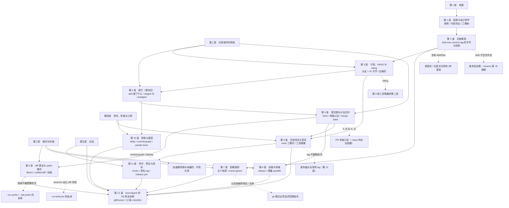

# 附录 C　知识地图与学习路径

> 这一份是"怎么用这本书"的地图：先看全书依赖关系，再查"我的困惑在哪一章"，
> 最后挑一条适合你的阅读路径。

---

## C.1　全书结构：5 个部分、12 章与 6 个附录



> 📌 **离线提示**：上面这张图需要联网渲染（用的是 Mermaid CDN）。
> 若你看到的是图源码而不是图，看下面这份**纯文本版依赖图**——内容是同一份。

<details>
<summary>点开：纯文本版依赖图（不依赖网络）</summary>

```
第一部　地基
├── 第 1 章　起源与设计哲学 ──→ 第 2 章　对象模型
│                              （哈希怎么算的）
├── 第 2 章　对象模型 ──────→ 第 3 章　引用、HEAD 与 reflog
│                              （对象不可变，所以引用才承担"可变"）
│                    ──────→ 第 7 章　忽略规则
│                    ──────→ X5 前缀可被配置改写（埋在第 6 章）
│
第二部　日常操作的真相
├── 第 3 章 ────────────────→ 第 4 章　索引（暂存区）
│                    ──────→ 第 9 章　历史改写与恢复（reflog 是第二层救援）
├── 第 4 章 ────────────────→ 第 5 章　提交图与分支合并
│                    ──────→ 第 10 章　性能与底层（stat 缓存）
└── 第 5 章 ────────────────→ 第 6 章、第 8 章、第 9 章
                             （A...B 口径 / merge-base 在 09 复现）
│
第三部　格式与传输
├── 第 6 章　diff 算法与 patch 格式 ──→ 第 12 章（--src-prefix / --no-textconv 的由来）
├── 第 7 章　忽略规则 ─────────────→ 第 12 章（必须显式回溯祖先）
└── 第 8 章　远端与传输 ────────────→ 第 12 章（我们不用 git 传输）
│
第四部　改写、性能与工程
├── 第 9 章　历史改写与恢复 ──────→ 第 11 章（tag 不跟随改写）
└── 第 10 章　性能与底层
│
第五部　实战
├── 第 11 章　钩子、签名与发布 ──→ 第 12 章
└── 第 12 章　sourcepack 的 Git 用法全解
       ↑ 收束 06 / 07 / 08 / 09 / 10 / 11 六章埋下的线

跨章伏笔（虚线）：
  空树 4b825dc          → 第 2 章 → X1「无提交仓库的 diff 基准」
  blob 不含文件名        → 第 2 章 → X2「重命名免费；-M 才推断」
  reflog                 → 第 3 章 → X3「第 9 章三层救援的第二层」
  A..B 与 A...B          → 第 5 章 → X4「PR 审查口径」
  前缀可被配置改写        → 第 6 章 → X5「--src-prefix 的由来」
  textconv 会让 diff 失败 → 第 6 章 → X6「--no-textconv 的由来」
  父目录被排除后 ! 无效   → 第 7 章 → X7「必须显式回溯祖先」
  tag 不跟随改写          → 第 9 章 → X8「发布锚点必须用 tag」
  commit-graph / bitmap   → 第 10 章 → X9「只加速，不改仓库」
```

</details>

**怎么读这张图**：

| 部分 | 章节 | 这一部分在回答什么 | 建议时长 |
| :--- | :--- | :--- | ---: |
| 第一部　地基 | 01–02 | Git 为什么长这样？对象到底是什么字节？ | 2.0 小时 |
| 第二部　日常操作的真相 | 03–05 | 分支、暂存区、合并——你每天都在碰的东西到底是什么 | 3.0 小时 |
| 第三部　格式与传输 | 06–08 | diff 文本、忽略规则、远端协商 | 3.0 小时 |
| 第四部　改写、性能与工程 | 09–10 | 改写与恢复、性能机制（含「为什么快」） | 2.0 小时 |
| 第五部　实战 | 11–12 | 钩子与发布，以及把前面所有结论逐条落回一份真实代码 | 2.0 小时 |
| 附录 A–F | — | 术语表、命令速查、知识地图、延伸阅读、进阶主题地图、可运行示例；用到时再查，不是拿来通读的 | — |

> **总时长约 12 小时**；若只想速成，见 [C.3 三种阅读路径](#c-3三种阅读路径) 的 3 小时路径（前提：日常在用 Git）。

> 图上最后一组虚线箭头是**跨部分的伏笔**：它们记录了"前面埋的线，在后面哪一章收"。
> 其中最容易被忽略的是指向 X5/X6 的两条——它们是从"用户配置"到"工具加固"的完整因果链。

---

## C.2　困惑 → 章节　对照表

照着左列找你的问题，右列是**直接给出答案**的那一节。

| 你的困惑（新手真实会问的） | 去哪一章 / 哪一节 |
| :--- | :--- |
| 我把提交 `reset` 掉了，还能救回来吗？ | 第 3.8 节（完整救援演练）、第 9.8 节（三层手段） |
| `reset --soft`、`--mixed`、`--hard` 到底差在哪？ | 第 9.2 节（三模式 × 三棵树对照表） |
| 为什么 `.gitignore` 明明写了，文件还在被提交？ | 第 7.4 节（`.gitignore` 只管未跟踪文件） |
| `.gitignore` 里的 `!` 有时候"不起作用"，为什么？ | 第 7.6.2 节（父目录被排除后 `!` 救不回） |
| `abc/**` 为什么不忽略 `abc` 自己？ | 第 7.6.1 节（补一个 `*` 段的来历） |
| `git diff main` 怎么把别人的改动也算进来了？ | 第 5.6 节（双点 vs 三点）、第 5.8.3 节（PR 审查的坑） |
| 审 PR 到底该用 `A..B` 还是 `A...B`？ | 第 5.6 节（实测 3 个文件 vs 2 个文件） |
| 合并之后 `git diff main...feature` 怎么是空的？ | 第 5.7 节（合并后被合并的分支成了祖先） |
| `git show <merge>` 为什么什么都不显示？ | 第 5.5 节（合并的"改动"取决于和哪个父比） |
| 改一下提交信息，为什么同事被迫重新 clone？ | 第 9.6 节（reword 让下游哈希全变）、第 9.9 节（铁律） |
| `--force` 和 `--force-with-lease` 有什么区别？ | 第 8.6 节（对照实验：`stale info` vs 静默丢提交） |
| `git fetch` 和 `git pull` 到底差在哪？ | 第 8.2、8.4 节（`fetch` 永远安全，`pull` 会动你的分支） |
| 为什么推送被拒（`non-fast-forward`）？ | 第 8.5 节（非快进保护）、第 8.9 节（排查清单） |
| 我说不清 staged / unstaged / untracked 的区别。 | 第 4.1 节（三棵树那张图）、第 4.4 节（porcelain 两列） |
| `git diff`、`git diff --cached`、`git diff HEAD` 各看什么？ | 第 4.5 节（一次测清三条边） |
| 同一个文件为什么可以既是 staged 又是 unstaged？ | 第 4.6 节（`MM` 与两份内容并存） |
| 冲突时 Git 到底把什么存起来了？ | 第 4.7 节（索引里的 stage 1/2/3） |
| `git add` 究竟写了哪些字节？ | 第 4.3 节（两步都可手工复现） |
| "分支"到底是什么？为什么说它很便宜？ | 第 3.1 节（41 字节的文件）、第 1.2 节（集中式对比） |
| `HEAD` 里的 `ref:` 是什么意思？ | 第 3.2 节（符号引用） |
| detached HEAD 是什么状态？为什么命令会失败？ | 第 3.7 节（`symbolic-ref` 失败、`rev-parse` 成功） |
| 为什么 `git init` 之后 `rev-parse HEAD` 会失败？ | 第 3.7 节（unborn HEAD 那一格） |
| 轻量标签和附注标签该用哪个？ | 第 3.4 节、第 11.6 节（发布说明放在哪） |
| `v2.0.1^{commit}` 里那对大括号是什么？ | 第 3.5 节（剥壳，tag → commit） |
| `HEAD@{1}` 和 `HEAD~1` 有什么不同？ | 第 3.5 节（操作史 vs 历史形状） |
| 对象哈希到底是怎么算出来的？ | 第 2.2 节（用 Python 逐字节复现） |
| `4b825dc642cb...` 这个常量是哪来的？ | 第 2.6 节（用 `git hash-object -t tree /dev/null` 复现） |
| 为什么重命名之后 diff 显示"删除 + 新增"？ | 第 2.8 节（blob 不含文件名）、第 6.8 节（`-M` 检测） |
| 我的中文文件名在 diff 里变成 `\344\275\240` 了。 | 第 8.8 节、第 12.2 节（`core.quotepath=false`） |
| 用户配的 `textconv` 让 `git diff` 直接报错了。 | 第 6.9 节（实测退出码 128）、第 12.5 节（`--no-textconv`） |
| `@@ -1,4 +1,5 @@` 这四个数字分别是什么？ | 第 6.4 节（hunk 头的数学） |
| diff 里 `a/` `b/` 前缀有一天突然变了。 | 第 6.7 节（`mnemonicPrefix` / `noprefix`） |
| `\ No newline at end of file` 该怎么读？ | 第 6.6 节（它标注的是**上一行**） |
| `--depth=1` 不是能让仓库更小吗？ | 第 10.2 节（实测体积涨 5.6×） |
| 为什么开了 commit-graph 有的命令快 3 倍、有的没变？ | 第 10.3 节（纯遍历受益、启动开销主导的不受益） |
| `--filter=blob:none` 在本地克隆时好像没生效？ | 第 10.6 节（两个静默陷阱） |
| `git status` 为什么能这么快？ | 第 4.2 节（stat 缓存）、第 10.5 节（untracked cache） |
| 钩子能不能代替 CI？ | 第 11.2 节（客户端可绕过、服务端不可绕过） |
| `--no-verify` 能绕过服务端钩子吗？ | 第 11.2 节（实测：不能，依然 `remote rejected`） |
| 为什么钩子没跟着克隆过来？ | 第 11.1 节（钩子不进版本库，`core.hooksPath` 也要各自设置） |
| 怎么用 SSH key 签名（我没有 gpg）？ | 第 11.3 节（`gpg.format=ssh` + `allowedSignersFile`） |
| 发布为什么必须用 tag 而不是分支？ | 第 9.7 节（tag 不跟随改写）、第 11.4 节（`on: push: tags`） |
| 我想写一个"读 Git"的工具，最该注意什么？ | 第 12.9 节（12 条 checklist）、附录 B.9（固定前缀） |
| 为什么清单解析要用 `-z` 而不是按行切？ | 第 12.4 节（路径里可以有空格、TAB、换行） |
| 自定义字段的分隔符该用什么？ | 第 12.3 节（0x1F，绝不用空格或 `\|`） |
| `git log` 在脚本里把进程挂住了，为什么？ | 第 12.2 节（分页器 + `GIT_PAGER=cat`） |
| 怎么"以 Git 为真值"测试自己的实现？ | 第 7.9.2 节（14 模式 × 40 路径对照）、第 12.7 节（三种做法） |

> 共 **47 行**。这张表刻意写得"像在搜索框里打的那句话"——困惑越大白话越好。

---

## C.3　三种阅读路径

### 路径一：速成路径（约 3 小时，只求"不再怕"）

适合：**已经在用 Git**、只想先把日常几个坑搞明白、暂时不打算写工具的人。
（前提是命令敲得动；完全没用过 Git 的读者请先补基础命令，这条路也会走得很吃力。）

| 顺序 | 读什么 | 时长 | 读完你获得 |
| ---: | :--- | ---: | :--- |
| 1 | 前言 + 第 1 章 | 30 分 | "快照 + 内容寻址 + 三棵树"的世界观 |
| 2 | 第 3 章 | 40 分 | 知道"提交丢了能救"，并亲手演练一次（3.8） |
| 3 | 第 4 章 | 40 分 | staged / unstaged / untracked 再也不会混 |
| 4 | 第 5.6–5.8 节（只读这三节） | 30 分 | PR 审查不再用错基准 |
| 5 | 第 7.4、7.6 节 | 20 分 | `.gitignore` 的两个"为什么不管用" |
| 6 | 第 9.2、9.8 节 | 30 分 | `reset` 三模式 + 三层救援 |

**这条路径跳过了**：第 2 章全部、第 6/8/10/11/12 章。跳过的代价是——你会用，但依然不知道为什么。

### 路径二：完整路径（约 12 小时，按书顺序）

适合：想真正建立模型的人（也是作者写作时的推荐顺序）。

| 阶段 | 章节 | 累计时长 | 关键动作 |
| :--- | :--- | ---: | :--- |
| 第一遍（建立骨架） | 01 → 03 | 2.5 小时 | 建好隔离克隆 `/tmp/git-lab`，把 01/02 的"动手实验"全敲一遍 |
| 第二遍（日常真相） | 04 → 05 | 3.0 小时 | 务必亲手造一次冲突（4.7）与一次分叉合并（5.2） |
| 第三遍（格式与传输） | 06 → 08 | 3.0 小时 | 跑一遍 `--no-index` diff（6.5）和裸仓库传输实验（8.11） |
| 第四遍（进阶） | 09 → 11 | 3.0 小时 | 第 9 章的救援演练**必须动手**，否则等于没读 |
| 收束 | 12 | 0.5 小时 | 对着 12.9 的 12 条 checklist 回看自己的代码与习惯 |
| 附录 | A–D | — | 当作手册，不占连续时间 |

> **一条硬建议**：所有破坏性实验都在隔离克隆里做——
> `git clone /path/to/repo /tmp/git-lab`。这也是全书第一条命令。

### 路径三：查阅路径（当手册用）

适合：已经会用 Git、只想知道"这个现象背后的机制"。

| 你手上正卡住的事 | 直接跳 | 配套的速查 |
| :--- | :--- | :--- |
| 一个术语看不懂 | 附录 A（按主题分组，含"易混点"） | — |
| 想找一条命令的确切作用 | 附录 B（按场景分组，收录书中全部命令） | — |
| 不知道某个问题该看哪章 | 附录 C.2 的对照表（47 行） | — |
| 想深入某个方向 | 附录 D（官方文档 / 论文 / 工具） | — |
| 要写"读 Git"的工具 | 第 12 章 + 附录 B.9 | 第 12.9 的 12 条 checklist |
| 出了事故要救火 | 第 9.8 节（三层手段） | 附录 B.3 的"引用与找回"组 |

**查阅路径的正确用法**：先查 C.2 定位章节 → 跳过去只读那一节 →
需要命令细节时回附录 B 对应分组 → 术语卡壳时查附录 A。

---

## C.4　时长估计总表

| 阅读方式 | 时长 | 说明 |
| :--- | ---: | :--- |
| 速成路径 | **约 3 小时** | 见 C.3 路径一，六步 |
| 完整路径 | **约 12 小时** | 12 章 + 每章动手实验，不含附录通读 |
| 只读正文不敲实验 | 约 5 小时 | 能看懂，但"恍然大悟"会少一半 |
| 查阅单节 | 10–30 分钟 | 每节都自带完整上下文 |
| 附录 A（查询用） | 按需 | 145 个条目，不是拿来通读的 |
| 附录 B（查询用） | 按需 | 按场景分组的命令速查 |
| 附录 D（延伸清单） | 15 分钟 | 挑感兴趣的方向再深入 |

**关于"动手实验"的时长**：全书 12 章共 12 组动手实验，全部敲一遍约需 **4 小时**
（其中第 9 章的救援演练与第 8 章的传输实验最花时间，也最值）。

> **一个诚实的提醒**：这本书不是"读完就会"的类型。它更像一本"操作手册 + 原理说明书"，
> 真正的掌握发生在你自己敲命令、拿到**和书上不一样的输出**、然后去查为什么的时候。
> 附录存在的意义，就是让那个时刻的查找成本降到最低。
