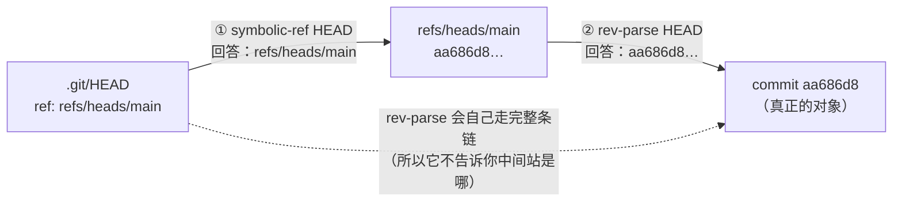
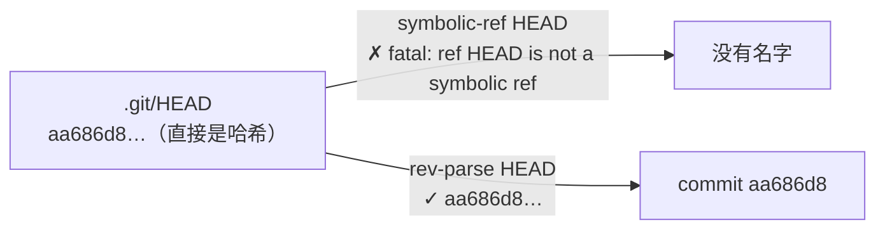
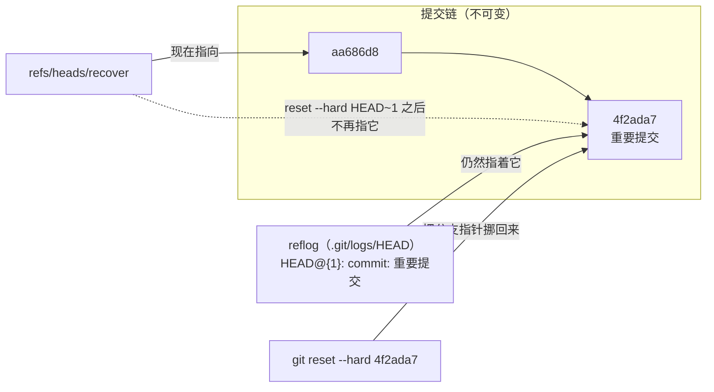

# 第 3 章：引用、HEAD 与 reflog

> **本章目标**：搞清"分支"到底是什么、"提交丢了"能不能救，以及 Git 为什么敢承诺
> "几乎所有误操作都可恢复"。学完你会理解：
> 对象库不可变（第 2 章） + 引用只是可移动的指针 = 历史永不被真正删除。
>
> 本章还会当场解掉第 2 章留的思考题：**手工造的提交怎么才能出现在 `git log` 里**。

---

## 3.1 引用就是文件

第 1 章说过 Git 内部只有三块东西，其中"引用"是**唯一可变**的部分。
它可变的方式非常朴素——**就是一个装着 40 位哈希的文本文件**：

```bash
# 新建一个分支（= 写一个 41 字节的文件）
$ git update-ref refs/heads/demo <sha>
$ cat .git/refs/heads/demo
94af1cd57e1573048348bc429bc053de2492dd1a
$ cat .git/refs/heads/demo | wc -c
41            # 40 位哈希 + 一个换行
```

**"创建分支"就是这么便宜**——第 1 章说的"分支廉价"，字面意思就是写个 41 字节的文件。

### 松散引用 vs 打包引用

引用可以以两种形态存在，**松散优先**：

| 形态 | 位置 | 何时出现 |
| :--- | :--- | :--- |
| 松散（loose） | `.git/refs/heads/<name>` | 每次提交/移动分支时新写 |
| 打包（packed） | `.git/packed-refs`（一个文件装很多引用） | `git gc` / `git pack-refs` 之后 |

**实测**：仓库里 44 个引用被打包，而新提交会立刻产生一个松散文件覆盖它 `[lab]`：

```bash
$ grep -c "refs/" .git/packed-refs
44
$ git commit -q --allow-empty -m "空提交"
$ cat .git/refs/heads/demo
94af1cd57e1573048348bc429bc053de2492dd1a     # ← 新写的松散引用，值已变
```

> **对工具的意义**：**永远不要自己读 `.git/refs/`**。你以为它在文件里，它可能在
> `packed-refs` 里，也可能在两者之中（松散优先）。sourcepack 一律用
> `git rev-parse` / `git show-ref` / `git for-each-ref` 去问 Git 本身——
> 这也是我们"不自己实现 git 层"的第一条具体收益。

---

## 3.2 HEAD 是"符号引用"

`.git/HEAD` 里装的**不是哈希，而是另一个引用的名字**：

```bash
$ cat .git/HEAD
ref: refs/heads/git-course
```

这叫**符号引用**（symbolic ref）。所以：

- `HEAD` 的意思是"我现在在哪个分支上"；
- `git rev-parse HEAD` 会**递归解析**：HEAD → refs/heads/git-course → 实际哈希；
- 直接问"HEAD 这个符号指向谁"要用另一个命令：

```bash
$ git symbolic-ref HEAD
refs/heads/git-course
$ git rev-parse --short HEAD
aa686d8
```

**这两个命令的区别是整个第 3 章的关键**：`symbolic-ref` 问"名字"，
`rev-parse` 问"值"。

**一条链，两种问法**（第 3.7 节的 detached HEAD 就是这条链的第二种形态）：



**detached 时这条链少了一环**：`.git/HEAD` 里直接写哈希，
于是"取名字"失败、"取值"照旧成功——这不是 bug，是设计（3.7 节）：



---

## 3.3 引用的命名空间

所有引用都在 `refs/` 下，按用途分命名空间：

```bash
$ git for-each-ref --format='%(refname)  →  %(objectname:short)'
refs/heads/git-course          →  aa686d8      # 本地分支
refs/remotes/origin/HEAD       →  aa686d8      # 远端分支（fetch 得到）
refs/remotes/origin/main       →  aa686d8
refs/tags/v1.0.0               →  962753c      # 标签
refs/tags/v1.0.1               →  b1feaa8
refs/tags/v2.0.1               →  c7a057a      # 注意：这不是 commit 的哈希（见 3.4）
```

除了 `for-each-ref` 能看到的这些，还有几个**特殊引用**（存在 `.git/` 根下）：

| 引用 | 含义 |
| :--- | :--- |
| `HEAD` | 当前所在位置 |
| `ORIG_HEAD` | 上次 `reset` / `merge` / `rebase` **之前**的位置（"后悔药"） |
| `FETCH_HEAD` | 上次 `fetch` 抓到了什么 |
| `MERGE_HEAD` | 正在合并的那个"对方"提交（合并冲突时存在） |
| `CHERRY_PICK_HEAD` | 正在 cherry-pick 的提交 |

**这些文件的存在与否本身就是状态**：比如 `.git/MERGE_HEAD` 存在 = 仓库正处于
"合并未完成"状态。`git status` 会据此提示你。

---

## 3.4 轻量标签 vs 附注标签（一个真实的 tag 对象）

| | 轻量标签（lightweight） | 附注标签（annotated） |
| :--- | :--- | :--- |
| 本质 | 一个**直接指向 commit** 的 ref | 一个**独立的对象**（第 4 种对象类型） |
| 创建 | `git tag name` | `git tag -a name -m msg` |
| `cat-file -t` | `commit` | `tag` |

**实测我们仓库的 v2.0.1**（`git tag -a` 创建的）`[lab]`：

```bash
$ git cat-file -t v2.0.1
tag
$ git cat-file -p v2.0.1
object aa686d8e14f8fc729a32a30d42dbf32c0b94b29f
type commit
tag v2.0.1
tagger yuanguangshan <yuanguangshan@gmail.com> 1791813987 +0800

v2.0.1: -h 末尾换成参数手册博客版（https://s.want.biz/sourcepack）
$ git cat-file -t lightweight-demo        # 对照：轻量标签
commit
```

**为什么发布要用附注标签**：它带**签名、日期、发布说明**，而且是一个不可变对象
（第 2 章：对象不可变）。我们的 goreleaser 工作流就是靠 `v*` 标签触发的——
`refs/tags/v2.0.1` 这个引用一旦推送，CI 就能拿到它。

---

## 3.5 revspec：引用系统的表达式语言

Git 允许用**文字表达式**指代任意提交。sourcepack 的 `--rev` 直接把你的输入交给
Git 解析，所以下面这些**全部可用**（实测）`[lab]`：

| revspec | 含义 | 实测结果 |
| :--- | :--- | :--- |
| `HEAD` | 当前提交 | ✅ |
| `HEAD~1` | 第一个父提交（往回 1 代） | ✅ |
| `HEAD@{1}` | **reflog 里的上一步**（3.8 节的主角） | ✅ |
| `handmade` | 任意引用名（分支/tag/远端） | ✅ |
| `v2.0.1` | 标签 | ✅ |

```
$ gx -g --rev HEAD@{1} --dry-run -d .
📦 Git changes: git diff HEAD@{1}  (working tree + index vs HEAD@{1})
```

常用语法速查：

| 写法 | 含义 |
| :--- | :--- |
| `<rev>~<n>` | 沿**第一父**往回 n 代 |
| `<rev>^<n>` | 第 n 个父（合并提交：`^1` 主线、`^2` 被并进来的分支） |
| `<rev>@{<n>}` | 该引用的第 n 步 reflog（`@{0}` 是当前） |
| `<rev>@{<time>}` | 按时间：`HEAD@{yesterday}`、`main@{2.hours.ago}` |
| `<rev>:<path>` | 该版本下的某个文件（`HEAD:README.md`） |
| `<rev>^{commit}` | **剥壳**：一路剥到 commit（tag → commit，见下） |
| `<rev>^{tree}` | 剥到 tree |

### 剥壳 `^{commit}`：为什么 sourcepack 需要它

`v2.0.1` 是附注标签，它的哈希指向一个 **tag 对象**，不是 commit：

```bash
$ git rev-parse v2.0.1
c7a057a324abc15567c01951c1003be614f94608      # tag 对象
$ git rev-parse "v2.0.1^{commit}"
aa686d8e14f8fc729a32a30d42dbf32c0b94b29f       # 它指向的提交
```

所以 `changeset.go` 的 `collectHistory` 用 `^{commit}` 校验用户给的 `--rev`
（本版在 334 行附近）：

```go
	} else if _, err := g.run("rev-parse", "--verify", base+"^{commit}"); err != nil {
```

**实测这个校验的价值**：给它一个**树对象**（合法 revspec，但不是提交）也会被拦住，
并给出可读报错：

```bash
$ gx -g --rev "not-a-rev" --dry-run -d .
❌ invalid --rev "not-a-rev": git rev-parse --verify not-a-rev^{commit} failed:
   fatal: Needed a single revision
```

**这里体现两种设计的选择**：我们**不解析 revspec**（那是 Git 的领域，规则极多），
只做两件事——① 让 Git 去解析；② 把 Git 的报错包装成用户能看懂的一句话。

---

## 3.6 第 2 章思考题解答：怎么让"手工提交"进入历史

第 2 章我们用 plumbing 造了一个提交，但它不出现 `git log` 里。原因很简单：
**提交之间不靠"列表"连接，靠的是"引用能到达它"**。`git log` 的起点是引用
（默认 HEAD），顺着 `parent` 边回溯——没有引用指向的提交就是"不可达"的。

**实测**（同一个提交，加引用前后）`[lab]`：

```bash
$ C=$(git commit-tree "$TREE" -m "手工提交：现在给它一个引用")
$ git log --oneline --all | grep -c b42db3a
0                                   # ← 加引用之前：找不到
$ git update-ref refs/heads/handmade "$C"
$ git log --oneline --all | grep -c b42db3a
1                                   # ← 加引用之后：出现了
$ git log --oneline -1 handmade
b42db3a 手工提交：现在给它一个引用
```

**所以"创建分支"= 给某个提交一个名字**。这也解释了 `git branch <name> <sha>`
为什么可以给**任意**提交起名字——包括你以为已经丢掉的提交（见 3.8）。

---

## 3.7 detached HEAD：符号引用会"断"

`git checkout <sha>` / `git checkout --detach` 会让 HEAD **不再指向分支**，
而是直接指向一个提交：

```bash
$ git checkout -q --detach HEAD~1
$ git status
HEAD detached at aa686d8
$ git symbolic-ref --short HEAD
fatal: ref HEAD is not a symbolic ref        # ← 这个命令失败了
$ git rev-parse --short HEAD
aa686d8                                       # ← 但值还是能取到
```

**这就是为什么"取值"和"取名字"必须分开**：detached 状态下有值、没有名字。

### 回到 sourcepack：我们的三段式回退

`changeset.go:282-288` 正是为这三种状态写的（**代码原样**）：

```go
	if br, berr := g.run("symbolic-ref", "--short", "HEAD"); berr == nil && strings.TrimSpace(br) != "" {
		cs.Branch = strings.TrimSpace(br)
	} else if sha, serr := g.run("rev-parse", "--short", "HEAD"); serr == nil {
		cs.Branch = "detached at " + strings.TrimSpace(sha)
	} else {
		cs.Branch = "(no commits yet)"
	}
```

三种状态一一对应（**下面这张表是实测出来的，不是推想的**）：

| 状态 | `symbolic-ref --short HEAD` | `rev-parse HEAD` | sourcepack 显示 |
| :--- | :--- | :--- | :--- |
| 在分支上 | 成功 → `refs/heads/x` | 成功 | `Branch: x` |
| **detached HEAD** | **失败**（`fatal: ref HEAD is not a symbolic ref`） | 成功 | `Branch: detached at aa686d8` |
| **还没有任何提交**（unborn HEAD） | **仍然成功** → `main` | **失败**（退出码 128） | `Branch: main` + 警告（见下） |

**unborn HEAD 这一格值得停一下**：`git init` 之后、第一次提交之前，
`.git/HEAD` 里已经写着 `ref: refs/heads/main`，但 `.git/refs/heads/main`
**这个文件并不存在**——HEAD 是"指向一个还不存在的分支"的符号引用。
所以 `symbolic-ref` 成功、`rev-parse` 失败。

**实测（空仓库 + 一个未跟踪文件）** `[lab]`：

```bash
$ git init -q -b main . && printf 'package main\n' > a.go
$ git symbolic-ref --short HEAD
main                                  # 成功：符号引用有效
$ git rev-parse HEAD ; echo $?
128                                   # 失败：还没有提交对象
$ test -f .git/refs/heads/main || echo "分支文件不存在"
分支文件不存在

$ gx -g --dry-run -d .
📦 Git changes: git diff 4b825dc642cb6eb9a060e54bf8d69288fbee4904  (working tree + index vs 4b825dc...)
  Repository:          /private/tmp/unborn
  Branch:              main
  Files changed:       1 (+1 −0)
                       staged 0 · unstaged 0 · untracked 1
  ⚠ repository has no commits yet — diffing against the empty tree
```

**注意这一行的基准是 `4b825dc...`——正是第 2 章那个空树对象。**
源码在 `changeset.go:320` 附近：

```go
		cs.Warnings = append(cs.Warnings, "repository has no commits yet — diffing against the empty tree")
```

而 `-G`（按提交数打包）在无提交时直接报错（`changeset.go:444`），
因为"最近 N 个提交"没有可数的对象：

```bash
$ gx -G 3 --dry-run -d .
❌ repository has no commits yet: -G/--commits needs at least one commit
```

> **这里体现了第 2 章那个常量的第二个用途**：不仅是"根提交的基准"，
> 也是"整个仓库还没有提交时"的基准。`-g` 与 `-G` 面对同一状态给出不同反应
> （一个降级并警告、一个明确报错）也是有意为之：前者"相对空树看工作区"是
> **有意义的**（就是整个项目），后者"最近 N 个提交"**没有意义**。

**实测 detached 状态下的产物** `[lab]`：

```bash
$ gx -g --dry-run -d . | grep -E "Branch|HEAD"
  Branch:              detached at aa686d8
  HEAD:                aa686d8 docs: v2.0.1 记录（-h 末尾换成参数手册博客版）；还原 v2.0.0 的 help 引用为当时真实输出
```

> 注意第三行 `HEAD:` 是**另一个调用**的结果（`changeset.go:290`：
> `rev-parse HEAD` + `log -1 --format=%s`），与 `Branch` 分开取——
> 因为 detached 时"名字"没有，但"值"和"提交标题"都有。

---

## 3.8 reflog：Git 的"后悔药"（本章重头戏）

**reflog 是 Git 记录"引用是怎么移动的"的日志**，存在：

- `.git/logs/HEAD`（HEAD 的移动史）
- `.git/logs/refs/heads/<branch>`（每个分支各自的移动史）

**它不是历史，是"历史的历史"**——每次 checkout/commit/reset/merge/rebase 都追加一行。

**为什么"指针挪回去"就能救命**：分支只是指针，`reset` 只动指针；
提交对象一旦写进对象库就不可变，只要还有**任何**引用（分支、tag、reflog）指着它，
`gc` 就不会回收：



**读法**：`reset --hard` 只做两件事——**挪指针**（`refs/heads/...`）和
**同步工作区**（把文件改回去）。它**不删除对象**。所以"救回来"的完整条件只有一条：
那个提交的哈希还在某处被记着（reflog 就是最可靠的那一处）。

### 完整实验：把提交 reset 掉，再救回来 `[lab]`

```bash
# 1) 造一个"重要提交"
$ printf 'important\n' > important.txt
$ git add important.txt && git commit -q -m "重要提交：马上会被我 reset 掉"
$ GOOD=$(git rev-parse HEAD)
$ git log --oneline -1
4f2ada7 重要提交：马上会被我 reset 掉

# 2) 事故：硬重置回上一个提交
$ git reset --hard HEAD~1
HEAD is now at aa686d8 docs: v2.0.1 记录（...）
$ test -f important.txt || echo "文件不在了（工作区被重置）"
文件不在了（工作区被重置）
$ git log --oneline | grep -c 4f2ada7
0                                   # ← 从"当前历史"里消失了

# 3) 救援第一步：reflog 记得一切
$ git reflog -5
aa686d8 HEAD@{0}: reset: moving to HEAD~1
4f2ada7 HEAD@{1}: commit: 重要提交：马上会被我 reset 掉     # ← 就在这儿
aa686d8 HEAD@{2}: checkout: moving from aa686d8... to recover

# 4) 救援第二步：把引用指回去
$ git reset --hard "$GOOD"
HEAD is now at 4f2ada7 重要提交：马上会被我 reset 掉
$ cat important.txt
important                            # ← 文件、历史、全部回来
$ git reflog -1
4f2ada7 HEAD@{0}: reset: moving to 4f2ada71141360476dd16561680c432a695e256b
```

**四个值得记住的观察**：

1. `reset --hard` 后提交"看不见了"，但**对象还在磁盘上**（第 2 章的不可变性）；
2. reflog 是**本地**的：clone 不会带上别人的 reflog（所以它是"个人操作史"）；
3. 救援动作本身也被记进 reflog——reflog 是追加日志，不会被"覆盖"；
4. 同理，`git reset` 回退分支**不会丢提交**，只是把指针往后挪。

### reflog 也会过期

| 配置 | 默认 | 含义 |
| :--- | :--- | :--- |
| `gc.reflogExpire` | 90 天 | HEAD 的 reflog 保留期 |
| `gc.reflogExpireUnreachable` | 30 天 | 不可达提交的 reflog 保留期 |

过期 + `git gc` 之后，没有任何引用的对象才会被真正清除。
**所以"事故后别慌、别急着 gc"是有道理的**——reflog 还在，就能救。

---

## 3.9 reflog 也没了怎么办：dangling 对象与 `fsck`

如果提交从来没被引用过（比如第 2 章手工造的），reflog 里也不会有它。
但**对象仍在对象库里**，`git fsck` 能看到"没人引用"的对象：

```bash
$ git fsck --lost-found | grep -c "dangling commit"
6                                    # ← 6 个吊着的提交（含我实验里造的那些）
$ git log --oneline -1 8c8ccb5        # 直接按哈希读
8c8ccb5 孤儿提交
```

| 概念 | 含义 |
| :--- | :--- |
| **可达对象** | 从某个引用出发、顺着 parent/tree 能找到的 |
| **dangling（吊着的）对象** | 对象库里存在、但没有任何引用能到达 |
| 会被 gc 删掉吗 | 只有"过期 + 不可达"才会。reflog 里的引用也算一种到达 |

**实用技巧**：`git fsck --lost-found` 会把吊着的对象写进 `.git/lost-found/`；
`git fsck --unreachable` 只列不写。找到哈希后用 `git show <sha>` 看内容，
`git branch rescue <sha>` 把它救回历史。

---

## 3.10 回到 sourcepack：一行行对照

| 代码位置 | 做什么 | 对应本章概念 |
| :--- | :--- | :--- |
| `changeset.go:256` `rev-parse --show-toplevel` | 找仓库根 | 不自己找 `.git`，问 Git |
| `changeset.go:271` `rev-parse --show-prefix` | 算子目录作用域 | 用 Git 的路径语义（绕开 `/tmp` 软链坑） |
| `changeset.go:282-285` `symbolic-ref` → `rev-parse` | 分支名 / detached | **符号引用 vs 值** |
| `changeset.go:287` `(no commits yet)` | unborn HEAD 的兜底 | 第三种状态 |
| `changeset.go:290-297` `rev-parse HEAD` → `log -1 --format=%s` | 取当前提交与标题 | 递归解析；无提交时退到 `(no commits yet)` |
| `changeset.go:292` `log -1 --format=%s` | 取提交标题 | commit 对象的 message |
| `changeset.go` 的 `rev-parse --verify <base>^{commit}` | 校验 `--rev` | **剥壳** + 让 Git 报错（unborn 时走同函数里的空树分支） |
| `changeset.go:564` `shortSHA(s)` | 取前 7 位 | Git 的最小无歧义缩写习惯 |

`shortSHA` 的实现（我们**没有**调 `git rev-parse --short`，因为哈希已在手）：

```go
func shortSHA(s string) string {
	if len(s) > 7 {
		return s[:7]
	}
	return s
}
```

> **一个诚实的注脚**：硬截 7 位在**超大仓库**里理论上有歧义风险
> （Git 默认会自动加长到无歧义）。sourcepack 的场景是"给人看的摘要"，
> 且同一产物里同时有完整路径与提交标题，所以这个简化是可接受的——
> 但如果哪天要拿它当**唯一标识**去查询，就该换成
> `git rev-parse --short=8` 或 `git rev-parse --verify <short>^{commit}`。

---

## 3.11 动手实验 `[lab]`

```bash
cd /tmp/git-lab

# 1) 引用就是文件
git update-ref refs/heads/demo HEAD
cat .git/refs/heads/demo          # 看它只有 41 字节
cat .git/packed-refs | head -3    # 打包形态
git for-each-ref --format='%(refname) → %(objectname:short)'

# 2) 名字 vs 值
cat .git/HEAD
git symbolic-ref HEAD
git rev-parse HEAD

# 3) 让手工提交进入历史（第 2 章思考题）
BLOB=$(printf 'x\n' | git hash-object -w --stdin)
TREE=$(printf '100644 blob %s\tx.txt\n' "$BLOB" | git mktree)
C=$(git commit-tree "$TREE" -m "手动提交")
git log --all --oneline | grep "$(echo $C | cut -c1-7)" || echo "不可达：log 里没有"
git update-ref refs/heads/handmade "$C"
git log --oneline handmade

# 4) detached HEAD 与三段式回退
git checkout --detach HEAD~1
git symbolic-ref HEAD ; echo "上一条命令的退出码: $?"
gx -g --dry-run -d . | grep Branch
git checkout -  # 回到原分支

# 5) 救援演练（本章必须动手做一遍）
printf 'x\n' > rescue.txt && git add rescue.txt && git commit -q -m "待救提交"
GOOD=$(git rev-parse HEAD)
git reset --hard HEAD~1
git reflog -3
git reset --hard "$GOOD"
cat rescue.txt
```

**自测题**：

1. `git branch new` 和 `git update-ref refs/heads/new HEAD` 等价吗？
2. `HEAD@{1}` 与 `HEAD~1` 有什么本质不同？（提示：一个是"历史的形状"，一个是"你的操作史"）
3. 为什么 `git clone` 之后，别人看不到你本地的 reflog？
4. 一个提交既没有分支指向、也没有 tag、reflog 也已过期——它一定被删了吗？
5. 为什么 sourcepack 判断"分支名"要先用 `symbolic-ref` 而不是直接 `rev-parse HEAD`？

<details>
<summary>点开看答案</summary>

1. **在"引用文件的值"这一层等价，命令行为不同。** 两者写出的 `.git/refs/heads/new`
   内容完全一致（实测同为 HEAD 的哈希 + 一个换行）。差别有三处：① `git branch`
   会拒绝重名（实测 `fatal: a branch named 'newbranch' already exists`），
   `git update-ref` 不做存在性校验、同名静默覆盖；② reflog 文案不同（`git branch`
   写 `branch: Created from main`，`update-ref` 写一条空消息记录）；③ `git branch`
   一定写进 `refs/heads/`，而 `update-ref` 按你给的路径原样写文件——实测
   `git update-ref new3 HEAD` 会在 `.git/new3` 造出一个 `git show-ref` /
   `for-each-ref` 都看不见的"引用"。这正是 3.1"引用只是文件"的直接后果。

2. **`~1` 走的是提交图的形状，`@{1}` 走的是你的操作史。** `HEAD~1` 沿**第一父**
   往回一代，描述的是提交之间客观的 `parent` 边（3.5 速查表）；`HEAD@{1}` 是 HEAD
   的 reflog 里的上一步，描述的是本地真实发生过的操作序列（3.8）。实测：把 HEAD
   硬重置到根提交后，`git rev-parse HEAD~1` 直接失败（根提交没有父），而 `HEAD@{1}`
   仍指向刚被 reset 掉的那个提交——3.8 的"后悔药"能成立，靠的就是这个区别。

3. **因为 reflog 是本地的操作日志，不是仓库内容。** `clone` / `fetch` 传输的是
   对象与引用（ref → 哈希），而 reflog 放在 `.git/logs/` 下，既不是对象、也不作为
   一种引用参与传输（3.8 观察 2）。实测：`git clone` 之后新仓库的 `git reflog`
   只有一条 `clone: from <路径>`，源仓库那些 `commit: ...` 一条都没带过来；
   注意新仓库里 `.git/logs/HEAD` 是存在的，只是内容从 clone 那一刻重新开始。

4. **不一定——判据是"有没有被 gc 清掉"，不是"有没有引用"。** 对象不可变（第 2 章），
   只要还没被 `gc` prune，就能按哈希直接读出来：`git show <sha>`，这正是 3.9 说的
   dangling 状态。实测：手工造一个从未被引用的提交，`git log --all` 里 0 条，
   但 `git fsck --unreachable` 能列出它、`git show <sha>` 正常输出。3.9 的表说明：
   要真正消失，得"reflog 过期 + 不可达"同时满足、再被 gc 清理。

5. **因为两个命令回答的是不同问题：`symbolic-ref` 问"名字"，`rev-parse` 问"值"。**
   对照 3.7 那张实测表：detached HEAD 时 `rev-parse HEAD` 照样成功（有值），只有
   `symbolic-ref` 会失败（`fatal: ref HEAD is not a symbolic ref`）；unborn HEAD
   反过来——`symbolic-ref` 成功拿到 `main`、`rev-parse` 退出码 128。所以只看
   `rev-parse` 分不出"在分支上"和"detached"，也就拼不出 sourcepack 的三段式
   （`changeset.go:282-288`，实测输出 `Branch: detached at aa686d8`）。

</details>

---

## 3.12 小结

- **引用 = 装着哈希的文件**（松散 `.git/refs/...` 或打包 `.git/packed-refs`，松散优先），
  创建分支的代价就是写 41 字节；
- **HEAD 是符号引用**（指向另一个引用）；`symbolic-ref` 问名字、`rev-parse` 问值，
  detached HEAD 时前者失败、后者成功；
- 引用按命名空间组织：`heads` / `remotes` / `tags`，另有 `ORIG_HEAD`、`FETCH_HEAD`、
  `MERGE_HEAD` 等特殊引用（**它们的存在与否本身就是仓库状态**）;
- **附注标签是独立对象**（`cat-file -t` = `tag`），轻量标签直接指向 commit；
- revspec 是引用系统的表达式语言（`~`、`^`、`@{n}`、`^{commit}`）；
  sourcepack 不自己解析，只做校验 + 包装报错（`changeset.go` 的 `^{commit}` 校验）；
- **提交靠"引用可达"进入历史**——这是第 2 章思考题的答案（`update-ref` 0 次 → 1 次）；
- **reflog 是后悔药**：`reset --hard` 丢的提交可以靠 `HEAD@{n}` 找回来（完整实验见 3.8），
  reflog 过期后还能靠 `fsck` 找 dangling 对象，**最终救回靠的还是"对象不可变"**；
- sourcepack 的分支名三段回退（`symbolic-ref` → detached → no commits yet）是本章
  概念在真实代码里的落地，实测输出 `Branch: detached at aa686d8`。

**下一章**：索引（暂存区）——`git add` 到底写了什么、为什么会有 staged/unstaged 两种
状态、以及 sourcepack 的 `--staged` 为什么曾经把计数写成了恒为 0。
