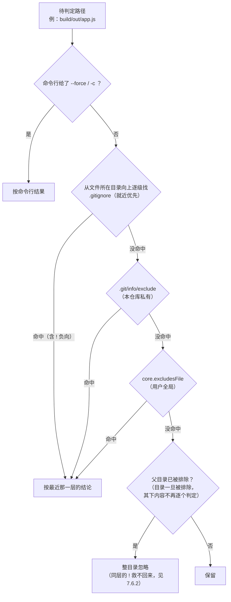

# 第 7 章：忽略规则

> **本章目标**：把 `.gitignore` 从"抄来的模板"变成"我能预测其行为"的规则系统。
> 学完你能回答：为什么 `abc/**` 不忽略 `abc` 自己？为什么 `!` 有时候"不起作用"？
> 为什么 `.gitignore` 挡不住已经被提交的文件？
> 以及——**为什么 sourcepack 明明调 git，却还要自己写一套匹配器**。

---

## 7.1 忽略规则有五个来源，优先级不同

| 来源 | 位置 | 是否进版本库 | 优先级 |
| :--- | :--- | :--- | :--- |
| **命令行** | `git add --force`、`git check-ignore` 的 `-c` 配置等 | — | **最高** |
| **`.gitignore`** | 仓库各层目录 | 是（可共享） | 中（**就近优先**） |
| **`.git/info/exclude`** | 仓库内部 | **否**（本地） | 中低 |
| **`core.excludesFile`** | 用户全局（如 `~/.config/git/ignore`） | 否 | 低 |
| `.gitattributes` 的 `export-ignore` | 仓库 | 是 | 只管 `git archive`，**与忽略无关** |

**实测三种来源同时生效**（`git check-ignore -v` 会告诉你"被谁命中的"）：

```bash
$ git check-ignore -v root.log                    # 仓库 .gitignore
.gitignore:1:*.log	root.log
$ git check-ignore -v local-only.txt              # .git/info/exclude
.git/info/exclude:1:local-only.txt	local-only.txt
$ git config core.excludesFile /tmp/global-excludes.txt
$ git check-ignore -v global-ignore.tmp           # 全局忽略
/tmp/global-excludes.txt:1:global-ignore.tmp	global-ignore.tmp
```

**为什么要有三套**：

- `.gitignore`：**团队共享**的规则（构建产物、依赖目录）；
- `.git/info/exclude`：**你自己的**本地噪音（编辑器临时文件），不想让同事看到；
- `core.excludesFile`：**你所有仓库**的通用规则（`.DS_Store`、`*.swp`）。

**判定一个路径时，规则的生效顺序**（自上而下，先命中先赢；`!` 只在同一层里能翻盘）：



**读法**：两条最容易记错的规则都在这张图上——
① **就近优先**：嵌套 `.gitignore` 里更靠近文件的规则覆盖外层；
② **目录被排除 = 整棵子树短路**：判定在"目录"这一层就结束了，不会走到目录内部
再让 `!` 逐文件翻盘（7.6.2 的实测就是这个）。
另外别忘了 7.4 节的前提：**这些规则只作用于未跟踪文件**——已入库的文件它管不着。

---

## 7.2 语法全表

| 写法 | 含义 |
| :--- | :--- |
| `*.log` | 不含 `/` → 匹配**任意层级**的名字 |
| `/build` | 前导 `/` → 锚定到**该文件所在目录**（这里是仓库根） |
| `build/` | 尾部 `/` → **只匹配目录**，且其下内容一并忽略 |
| `**/foo` | 零层或多层目录 |
| `foo/**` | foo **内部**的内容（**不含 foo 自身**，见 7.6） |
| `a/**/b` | `a/b`、`a/x/b`、`a/x/y/b` |
| `!keep.log` | 负向模式（重新纳入），按"**最后一条命中的规则**生效" |
| `\#name`、`\!name` | 字面量的 `#` / `!` |
| `temp?`、`[ab]c.txt` | `?` 单字符；`[...]` 字符组（`[!...]` 取反） |
| `# 注释`、空行 | 忽略 |
| 行尾空格 | 未转义的行尾空格会被剥掉 |

**关于 `\#` 与 `\!` 的实测**（很容易写错的一处）：行首的 `#` 会被当成注释，
所以想忽略一个真的叫 `#hash.txt` 的文件，必须转义：

```bash
$ printf '#hash.txt\n'  > .gitignore ; git check-ignore -q '#hash.txt' ; echo $?
1                       # ← 行首 # 被当注释，文件根本没被忽略
$ printf '\\#hash.txt\n' > .gitignore ; git check-ignore -q '#hash.txt' ; echo $?
0                       # ← 转义后才真正生效
```

> **注意**：`git check-ignore` 的**参数是路径**，不是模式——想验证某个模式，
> 要把它写进 `.gitignore` / `.git/info/exclude` / `core.excludesFile` 之后再做检查。
> 我第一版就在这里写错了（以为能直接传模式），实测纠正。

---

## 7.3 `git check-ignore -v`：排查忽略问题的第一工具

它不只回答"是否忽略"，还回答"**被哪个文件的第几行、哪条模式忽略**"：

```bash
$ git check-ignore -v app.log keep.log build/out.o sub/skip.txt deep/x.tmp
.gitignore:4:!keep.log	keep.log
.gitignore:3:build/	build/out.o
.gitignore:5:sub/skip.txt	sub/skip.txt
.gitignore:6:**/deep/*.tmp	deep/x.tmp
```

**格式**：`来源文件:行号:模式<TAB>路径`。

注意第 1 行：`keep.log` 被**负向规则** `!keep.log` 命中——它列出来是因为
"命中的规则是这条"，而 `!` 的含义是"**不要**忽略"。**判断是否真的被忽略要看退出码**：

```bash
$ git check-ignore -q keep.log ; echo $?
1                  # ← 退出码 1 = 没有任何规则让它被忽略（保留）
$ git check-ignore -q app.log ; echo $?
0                  # ← 0 = 被忽略
```

> **踩坑提示**：退出码只在**用 `-q` 查单个路径**时才可靠，
> 而且 `-q` **只接受一个路径**——传多个会直接报错（实测）：
>
> ```bash
> $ git check-ignore -q a.log keep.log          # -q 配多路径：不是"退出 1"，是直接失败
> fatal: --quiet is only valid with a single pathname
> $ echo $?
> 128
> ```
>
> 不带 `-q` 时它**只打印被忽略的路径**（未忽略的静默跳过），退出码为 **0**；
> 所以"多路径 + 看退出码"这个组合本身不成立。要批量判定，把路径用
> `git check-ignore --stdin -v` 逐行喂进去，或者干脆一次查一个。

**其它排查命令**：

| 命令 | 用途 |
| :--- | :--- |
| `git status --ignored` | 连被忽略的文件一起列（`!!` 前缀） |
| `git clean -ndX` | **演习**：列出"只删被忽略文件"会删掉什么（`-n` 演习，`-X` 只删忽略项） |
| `git ls-files --others --exclude-standard` | 未跟踪且未被忽略的文件（**sourcepack 取未跟踪清单用的就是它**） |
| `git check-ignore -v --no-index <p>` | 连**已跟踪**文件也按规则判定（见 7.4） |

实测：

```bash
$ git status --ignored --porcelain
 M .gitignore
?? a/
!! build/
!! deep/
!! sub/skip.txt
$ git clean -ndX
Would remove build/
Would remove deep/
Would remove sub/skip.txt
```

---

## 7.4 **`.gitignore` 只管未跟踪文件**（最常见的误解）

```bash
$ git add -f app.log && git commit -m "强制跟踪 app.log"
$ git ls-files --error-unmatch app.log >/dev/null && echo 已跟踪
已跟踪
$ git check-ignore -q app.log ; echo $?
1                                    # ← 已跟踪文件：check-ignore 直接说"不忽略"
$ git status --porcelain app.log
 M app.log                           # ← 照常显示修改

$ git rm --cached app.log            # 取消跟踪
$ git check-ignore -q app.log ; echo $?
0                                    # ← 现在又被忽略了
```

**规则**：`.gitignore` 的作用是"**决定哪些未跟踪文件不出现在 `git status` / `git add .` 的候选里**"。
一旦文件已进索引，忽略规则对它**完全无效**——它照常显示修改、照常被提交。

**实用推论**：

- "我把它写进 `.gitignore` 了，为什么还在被提交？" → 因为它已经被跟踪，
  需要 `git rm --cached`（保留工作区文件）才会"脱离版本控制"；
- "为什么同事那边这个文件没被忽略？" → `.gitignore` 是**工作区文件**，必须提交并推送才对别人生效；
  本地规则请用 `.git/info/exclude`。

---

## 7.5 嵌套 `.gitignore` 与"就近优先"

规则：**每一层目录的 `.gitignore` 都生效**；冲突时"**更深的目录里的规则**"优先；
同一个文件内"**最后一条命中的规则**"赢。

**实测**：根 `.gitignore` 是 `*.log` + `!keep.log`，而 `sub/.gitignore` 里顺序相反：

```bash
$ cat .gitignore            $ cat sub/.gitignore
*.log                       !keep.log
!keep.log                   *.log

$ for f in root.log keep.log sub/a.log sub/keep.log; do git check-ignore -v $f; done
.gitignore:1:*.log	root.log
.gitignore:2:!keep.log	keep.log          # ← 根目录的 ! 生效：保留
sub/.gitignore:2:*.log	sub/a.log
sub/.gitignore:2:*.log	sub/keep.log      # ← 子目录的 *.log 在 !keep.log 之后 → 忽略
```

**读法**：`sub/keep.log` 先命中 `!keep.log`（第 1 行），再命中 `*.log`（第 2 行），
后者更靠后 → 最终被忽略。**所以"顺序"是 `.gitignore` 里最容易被忽略的语义**。

---

## 7.6 两条反直觉规则（sourcepack 都踩过）

### 7.6.1 `abc/**` 不匹配 `abc` 自身

```bash
$ printf 'abc/**\n' > .gitignore
$ for p in abc abc/f.txt abc/d/deep.txt abcd; do
    printf "%-16s → %s\n" $p "$(git check-ignore -q $p && echo 忽略 || echo 保留)"; done
abc              → 保留
abc/f.txt        → 忽略
abc/d/deep.txt   → 忽略
abcd             → 保留
```

**原因**：git 的定义是"`abc/**` 匹配 `abc` **内部**的内容"，
所以零层的 `**` 在这里**不被允许**——必须至少有一层。
而相反地，**前导** `**/`（`**/foo`）必须允许零层（否则根目录下的 `foo` 匹配不到）。

**sourcepack 的实现**（`ignore.go:275-279`）：

```go
	// abc/** 表示"abc 内部的内容"（不含 abc 自身）：补一个 * 段要求至少一层，
	// 否则 ** 会匹配零层、把 abc 自己也吞掉。**/ 开头则必须允许零层。
	if len(r.segs) > 1 && r.segs[len(r.segs)-1] == "**" {
		r.segs = append(r.segs, "*")
	}
```

**一行代码就体现了这条规则的方向性**——这也是"自己实现匹配器"最容易写错的地方之一。

### 7.6.2 父目录被排除后，`!` 救不回来

```bash
$ printf 'a/**/b\n!a/b/c\n' > .gitignore
$ mkdir -p a/b && printf 'x\n' > a/b/c
$ git check-ignore -q a/b    ; echo $?    → 0（a/b 是目录，被 a/**/b 忽略）
$ git check-ignore -q a/b/c  ; echo $?    → 0（仍然被忽略！）
$ git check-ignore -v --no-index a/b/c
.gitignore:1:a/**/b	a/b/c                  # ← 归咎于 a/**/b，而不是!a/b/c
```

**git 的规则**：*"无法重新纳入一个其父目录已被排除的文件"*
（`It is not possible to re-include a file if a parent directory of that file is excluded`）。

**为什么**：Git 遍历到 `a/b` 时发现它被忽略，就**不再往里走**——
`a/b/c` 根本没被"看见"，自然无从被 `!` 救回。

**对照**：如果模式命中**文件**而不是目录，`!` 就有效：

```bash
$ printf '*.tmp\n!keep.tmp\n' > .gitignore && printf 'x\n' > keep.tmp
$ git check-ignore -q keep.tmp ; echo $?  → 1（保留 ✅）
```

**这条规则对工具的影响极大**（sourcepack 的两个模式处理方式不同）：

| 模式 | 怎么处理"目录下的内容" |
| :--- | :--- |
| **全量扫描**（遍历工作区） | 在目录上判定 → 命中就 `SkipDir`，天然满足 git 的规则 |
| **git 变更模式**（清单来自 git，没有遍历） | **必须显式回溯各级父目录**，否则 `a/b/c` 会被当成"未被忽略"漏进产物 |

源码（`ignore.go:103-115`）：

```go
	// 祖先目录被忽略 → 本路径也被忽略，而且**无法用 ! 重新纳入**
	// （git 的原话：不能重新纳入"父目录已被排除"的文件）。
	// 遍历模式靠 SkipDir 达到同样效果，但 git 变更模式没有遍历，必须在这里兜住。
	comps := strings.Split(relPath, "/")
	for i := 1; i < len(comps); i++ {
		if v := m.dirVerdict(strings.Join(comps[:i], "/")); v.ignored {
			return true, true, v.source
		}
	}
```

> **我在实现这块时的真实经历**：对照测试第一次跑就报了一处不一致——
> `a/**/b` 之下 `a/b/c` 我判成"保留"，git 判成"忽略"。
> 这条规则**不是靠想用例能覆盖到的**，是 `git check-ignore` 告诉我答案的。
> 这也说明"以 git 为真值"的测试策略有多值。

---

## 7.7 三种"看起来像忽略、其实不是"的东西

| 机制 | 真实作用 | 常见误用 |
| :--- | :--- | :--- |
| `git update-index --assume-unchanged <f>` | 告诉 Git"别检查这个文件的变化"（性能手段） | 当 `.gitignore` 用 → 克隆到别处就失效，还可能导致改动被静默忽略 |
| `git update-index --skip-worktree <f>` | 让 Git **忽略工作区版本**（用于本地配置覆盖） | 同上；且 `git pull` 撞上它时会报冲突 |
| `.gitattributes` 的 `export-ignore` | **只影响 `git archive`** 打包内容 | 以为它会阻止提交 → 不会 |
| 空文件 `.gitkeep` | 纯约定：让空目录能被提交（Git 不跟踪空目录） | 以为它有特殊功能 → 没有，任何文件名都行 |

---

## 7.8 跨平台的两个坑

### 7.8.1 路径分隔符：`filepath.Match` 在 Windows 会让 `*` 跨过 `/`

这是 **sourcepack 真实踩到的 bug**（v1.8.2 修复）：

- 我们内部的 `relPath` 一律用 `filepath.ToSlash` 归一（`/` 分隔）；
- 但 `filepath.Match` 是**平台相关**的：Windows 上它把 `\` 当分隔符、把 `/` 当普通字符；
- 于是 `src/*.go` 在 Windows 上会匹配 `src/sub/main.go` —— **过度排除**。

```go
// ignore.go:359-360
// 用 path.Match 而不是 filepath.Match：后者在 Windows 上把 \ 当分隔符、把 /
// 当普通字符，* 于是会跨过 /（这正是 CI 在 windows-latest 上抓到的差异）。
```

**CI 的报错原文**（三个 Windows job 同时挂）：

```
--- FAIL: TestMatchPattern (0.00s)
    main_test.go:40: matchPattern("src/sub/main.go", "src/*.go") = true, want false
```

**教训**：这类"只在某个平台成立"的差异，**没有对应平台的 CI 就永远发现不了**。
这也是我们把 `windows-latest` 加进矩阵的直接原因——加完当天就抓到它和
另一个 CRLF 问题（`gofmt` 把 CRLF 判成未格式化）。

### 7.8.2 大小写

| 平台 | 默认行为 |
| :--- | :--- |
| Linux | 大小写敏感（`core.ignoreCase=false`） |
| macOS / Windows | 文件系统大小写不敏感（git 会设 `core.ignoreCase=true`） |

后果：`.gitignore` 里写 `*.LOG` 在 macOS 上会匹配 `x.log`（因为文件系统不敏感），
在 Linux 上不会。**跨平台项目建议两边都写**，或统一小写命名。

---

## 7.9 回到 sourcepack：为什么要自己实现匹配器

一个自然的疑问：既然 sourcepack 到处调 git，**为什么忽略规则要自己写一套**？

答案有三层：

1. **`.gdignore` 是项目自己的机制**——git 完全不认识这个文件，
   而"不改项目 `.gitignore` 也能让快照跳过某些文件"是这个工具的特性；
2. **全量扫描必须在"不是 git 仓库"的目录里工作**（`gx -d /tmp/foo` 很常见）；
3. **git 模式虽然由 git 给清单，但 `.gdignore` 仍要叠加在 git 的结论之上**。

### 7.9.1 语义实现要点（`ignore.go`）

| 环节 | 做法 |
| :--- | :--- |
| 解析 | `parseIgnoreLine`：`#` 注释、`\!`/`\#` 字面量、`!` 负向、尾部 `/` 目录、行尾空格 |
| 切段 | 按 `/` 切；末尾 `**` 补一个 `*` 段（7.6.1） |
| 匹配 | `matchSegments` 支持 `**` 匹配零到多段；`segmentMatch` 用 **`path.Match`** |
| 目录规则 | `dirOnly` 命中任意一层父目录即命中（7.6.2） |
| 祖先传递 | `dirVerdict` + 缓存（避免深目录 O(深度²)） |
| 优先级 | 浅→深 `.gitignore` → 浅→深 `.gdignore` → 命令行 `-I` |

**"`.gdignore` 永远压过 `.gitignore`"这条是我们自己的规定**（git 没有这个概念）：
实现方式是"先遍历 `.gitignore` 的全部规则，再遍历 `.gdignore` 的"，
于是后者天然是"最后命中的规则"。

### 7.9.2 以 git 为真值的对照测试

`ignore_test.go` 里有一张**模式表 × 路径表**，逐个对比 `git check-ignore` 的结论：

```go
// 当前规模：14 个模式 × 40 条路径，完全一致
var oraclePatterns = []string{
	"*.log", "**/*.log", "**/*.tmp", "src/**/*.go", "**/node_modules",
	"a/**/b", "abc/**", "build/", "/rooted.txt", "docs/**/*.md",
	"*.min.js", "temp?", "[ab]racket.txt", "keep/**/deep.txt",
}
```

**为什么这比"多写几个用例"强**：模式的组合爆炸（锚定 × `**` 位置 × 目录规则 × 负向）
不是靠列举能覆盖的，而把判定权交给 git，就变成了"对齐一个已有实现"。

---

## 7.10 动手实验 `[lab]`

```bash
cd /tmp/git-lab
git checkout -q -B lab7 HEAD && git clean -qfd

# 1) 谁忽略的？—— check-ignore -v 是最强工具
cat > .gitignore <<'EOF'
*.log
!keep.log
build/
a/**/b
abc/**
EOF
mkdir -p build a/b abc/d && for f in app.log keep.log build/o.o a/b/c abc/f.txt; do mkdir -p $(dirname $f); echo x > $f; done
git check-ignore -v app.log keep.log build/o.o              # 来源文件:行号:模式
git check-ignore -q keep.log ; echo "keep.log 退出码 $?"    # 1 = 保留

# 2) 已跟踪文件不受忽略规则影响
git add -f app.log && git commit -qm "track app.log"
git check-ignore -q app.log ; echo $?        # 1：git 说"不忽略"（已跟踪）
git rm --cached -q app.log
git check-ignore -q app.log ; echo $?        # 0：回到未跟踪，又被忽略

# 3) 嵌套与顺序
printf '*.log\n!keep.log\n' > .gitignore ; mkdir -p sub
printf '!keep.log\n*.log\n' > sub/.gitignore ; touch sub/keep.log
git check-ignore -v sub/keep.log             # 子目录的第 2 行赢

# 4) 两个反直觉规则
printf 'abc/**\n' > .gitignore
git check-ignore -q abc ; echo "abc 退出码 $?（1=保留）"
printf 'a/**/b\n!a/b/c\n' > .gitignore
git check-ignore -v --no-index a/b/c         # 归咎于 a/**/b，! 无效

# 5) 三种来源
echo local-noise.txt > .git/info/exclude
printf 'global-noise.tmp\n' > /tmp/gx.txt && git config core.excludesFile /tmp/gx.txt
touch local-noise.txt global-noise.tmp
git check-ignore -v local-noise.txt global-noise.tmp
git config --unset core.excludesFile

# 6) 排查工具箱
git status --ignored --porcelain | head
git clean -ndX | head
git ls-files --others --exclude-standard
```

**自测题**：

1. `.gitignore` 为什么管不住已经提交的文件？怎么让一个文件"脱离版本控制但保留在工作区"？
2. `abc/**` 与 `**/abc` 的区别是什么？各自匹配到什么？
3. `!` 什么情况下"不起作用"？为什么？
4. `git check-ignore -v` 输出 `.gitignore:4:!keep.log	keep.log`，说明这个文件被忽略了还是被保留了？
5. 为什么 sourcepack 不干脆让 git 来决定一切忽略（而要实现 `.gdignore` 匹配器）？
6. `filepath.Match` 与 `path.Match` 在 Windows 上的差别会导致什么后果？

<details>
<summary>点开看答案</summary>

1. **因为忽略规则只作用于未跟踪文件**——它决定的是哪些文件不进 `git status` / `git add .` 的候选；
   一旦文件已进索引，规则对它**完全无效**。7.4 实测：`git add -f app.log` 提交后
   `git check-ignore -q app.log` 退出 1（不忽略），`git status --porcelain` 照常显示 ` M app.log`。
   要"脱离版本控制但保留工作区文件"，用 **`git rm --cached app.log`**（只删索引条目，磁盘文件不动）——
   实测之后 `check-ignore -q` 立刻回到退出 0（又被忽略）。
   补充：`.gitignore` 必须提交推送才对同事生效，纯本地噪音请放 `.git/info/exclude`。

2. **`abc/**` 匹配 `abc` 内部的内容（至少一层），不含 `abc` 自身；`**/abc` 的 `**` 允许零层，匹配任意层级（含仓库根）下叫 `abc` 的文件或目录。**
   7.6.1 实测 `abc/**`：`abc` 保留、`abc/f.txt` 与 `abc/d/deep.txt` 忽略、`abcd` 保留；
   我另外实测 `**/abc` 会把 `abc`、`x/abc`、`x/y/abc` 全部忽略（`abc` 作为目录被忽略后，其下 `abc/f.txt` 也一并忽略）。
   原因是 git 对 `abc/**` 的定义是"`abc` 内部"，零层的 `**` 在这里不被允许——sourcepack 的修法是
   给末尾 `**` 补一个 `*` 段（`ignore.go:275-279`）。

3. **两种情况下 `!` 不起作用**：① **父目录已被排除**：git 遍历到被忽略的目录就不再往里走，
   里面的文件根本没被"看见"，自然救不回来（7.6.2 实测 `a/**/b` + `!a/b/c`：`a/b/c` 仍退出 0，
   `git check-ignore -v --no-index a/b/c` 归咎于 `a/**/b`）；② **同一文件内后面还有一条命中的规则**：
   语义是"最后一条命中的规则生效"，`!` 写在前面就白写（7.5 实测 `sub/.gitignore` 里 `!keep.log` 在第 1 行、
   `*.log` 在第 2 行，`sub/keep.log` 最终被忽略）。对照：模式命中**文件**而不是目录时 `!` 有效
   （`*.tmp` + `!keep.tmp` → 保留）。

4. **被保留了——`!` 的含义是"不要忽略"，而 `-v` 打印的是"命中的规则"，不是判定结果。**
   7.3 的格式是 `来源文件:行号:模式<TAB>路径`，这行说明命中的是 `.gitignore` 第 4 行的负向规则 `!keep.log`。
   **真正判断是否被忽略要看退出码，而且要用 `-q` 单路径**：实测 `git check-ignore -q keep.log` 退出 1（保留）、
   `git check-ignore -q app.log` 退出 0（忽略）。两个坑要记住：`-v` 单独使用时负向命中也会退出 0
   （不能只看 `-v` 的退出码）；`-q` 一次只能给一个路径，传多个会直接
   `fatal: --quiet is only valid with a single pathname`（退出 128），所以排查时请一次查一个或配 `--stdin`。

5. **因为 git 只管 git 的忽略规则，而 sourcepack 有三件事必须自己扛（7.9）**：① `.gdignore` 是工具自己的机制，
   git 完全不认识它，而"不改项目 `.gitignore` 也能让快照跳过某些文件"是产品特性；②**全量扫描要在不是 git 仓库的
   目录里工作**（`gx -d /tmp/foo` 很常见），那里根本没有 `check-ignore` 可用；③即使在 git 模式（清单由 git 给），
   `.gdignore` 仍要叠加在 git 的结论之上，且我们规定"`.gdignore` 永远压过 `.gitignore`"。
   代价是要自己承担语义对齐的风险——`abc/**` 不含自身、父目录被排除后 `!` 无效都是踩过的坑，
   所以配了 14 模式 × 40 路径的 `git check-ignore` 对照测试来兜底。

6. **后果是 `*` 会跨过 `/`，造成过度排除。**
   `filepath.Match` 里 `*` 的定义是"匹配任意多个 **Separator** 字符"，而 `Separator` 是平台常量：
   Unix/macOS 上是 `/`，Windows 上是 `\`（我核对了 Go 1.24 的 `path/filepath/match.go`；`path.Match` 则写死"非 `/`"）。
   于是 `src/*.go` 在 Windows 上会匹配 `src/sub/main.go`——7.8.1 的 CI 原文就是
   `matchPattern("src/sub/main.go", "src/*.go") = true, want false`，三个 windows job 同时挂。
   修法是改用 `path.Match`（`ignore.go:367`），并把 `windows-latest` 加进 CI 矩阵；
   这类"只在某个平台成立"的差异，没有对应平台的 CI 就永远发现不了。

</details>

---

## 7.11 小结

- 忽略规则有**五个来源**、优先级不同：命令行 > `.gitignore`（就近/深者优先）
  > `.git/info/exclude` > `core.excludesFile`；`.gitattributes` 的 `export-ignore` 与忽略无关；
- 同一文件内**最后一条命中的规则**生效——顺序是语义的一部分（实测 `sub/keep.log` 的例子）；
- **`.gitignore` 只管未跟踪文件**：已跟踪文件照常修改与提交（`check-ignore` 对已跟踪文件退出 1，
  `git rm --cached` 后变 0）；
- `git check-ignore -v` 给出`来源文件:行号:模式`，是排查的第一工具；
  但它**不带 `-q` 时退出码恒为 0**，只是把未忽略的路径静默跳过——
  想用退出码判定必须 `-q` 且**一次只查一个**（多路径会 `fatal`，退出 128）；
- 两条反直觉规则：**`abc/**` 不含自身**（sourcepack 补一个 `*` 段）、
  **父目录被排除后 `!` 无效**（遍历靠 `SkipDir`、git 模式靠显式回溯祖先）；
- 跨平台坑：`filepath.Match` 在 Windows 让 `*` 跨过 `/`（我们改用 `path.Match`，
  并由 `windows-latest` CI 抓到）、大小写敏感性差异；
- sourcepack 自己实现匹配器的三层理由（`.gdignore` 是自有机制、非 git 目录要能扫、
  git 模式仍需叠加），并用 **14 模式 × 40 路径**的 `git check-ignore` 对照测试保证语义对齐。

**下一章**：远端与传输——refspec 语法、`fetch`/`push` 到底交换了什么、
packfile 协商与"增量传输"、`force-with-lease` 为什么比 `--force` 安全，
以及 sourcepack 的推送（`-p`）与 git 传输的区别（我们推的是产物，不是提交）。
