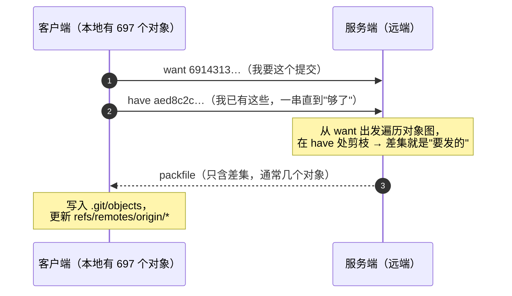

# 第 8 章：远端与传输

> **本章目标**：去掉"远端很神秘"的感觉。学完你能解释：
> `fetch` 到底改动了本地哪些文件？`+refs/heads/*:refs/remotes/origin/*` 每个符号什么意思？
> 为什么 `--force-with-lease` 能救命而 `--force` 会毁掉别人的提交？
> 以及**传输为什么是增量的**（有实测数字）。
>
> 本章所有实验都在本地用"裸仓库当远端"完成——不需要网络，也不需要任何服务。

---

## 8.1 远端就是一个普通的仓库（只是没有工作区）

```bash
$ git init -q --bare origin.git
$ ls origin.git
HEAD  config  description  hooks  info  objects  refs
```

**没有 `index`、没有工作区文件**——其余结构与第 1 章讲的完全一样：
对象库 + 引用。所谓"远端"只是**另一个可以被 fetch/push 的仓库**，
它并不特殊（第 1 章的分布式）：

```bash
$ git -C origin.git rev-parse --short main
6c71e63
$ git -C origin.git count-objects -v | grep ^count
count: 3              # 只有 3 个对象：1 commit + 1 tree + 1 blob
```

> **推论**：`git clone /path/to/repo` 与 `git clone https://...` 在**对象层面没有区别**，
> 只是"怎么把对象搬过来"的传输方式不同。这也是本章能用本地路径做全部实验的原因。

---

## 8.2 fetch 与 push：搬什么

| 操作 | 方向 | 搬动的东西 |
| :--- | :--- | :--- |
| `git fetch` | 远端 → 本地 | **对象**（补全本地缺的）+ **远端跟踪引用**（`refs/remotes/...`） |
| `git push` | 本地 → 远端 | 对象 + **远端的分支引用**（`refs/heads/...`） |

**关键差异**：`fetch` 只更新 `refs/remotes/origin/*`，**不碰你的本地分支、不动工作区**；
`push` 会移动远端仓库里的分支引用（这是"改变别人能看到的东西"，所以要保护——见 8.5）。

```bash
$ git config remote.origin.fetch
+refs/heads/*:refs/remotes/origin/*
```

---

## 8.3 refspec 语法拆解

`+refs/heads/*:refs/remotes/origin/*` 逐部分看：

| 部分 | 含义 |
| :--- | :--- |
| `+` | **允许非快进更新**（fetch 时很常见：远端被 force push 过，本地要跟着走） |
| `refs/heads/*` | 源（远端这一侧）的所有分支 |
| `:` | "映射到" |
| `refs/remotes/origin/*` | 目标（本地这一侧）的远端跟踪引用 |

**push 的显式形式**（实测）：

```bash
$ git push origin HEAD:refs/heads/bob-feature
$ git -C origin.git branch
  bob-feature
  main
```

**常用简写**：

| 写法 | 含义 |
| :--- | :--- |
| `git push origin main` | `refs/heads/main:refs/heads/main`（同名） |
| `git push origin HEAD` | 把当前提交推到远端**同名分支** |
| `git push origin :branch` | 源为空 → **删除**远端分支 |
| `git fetch origin main` | 只取 main（仍然写进 `refs/remotes/origin/main`） |
| `git fetch origin main:tmp` | 直接写进本地 `tmp` 分支（不经过 `refs/remotes`） |

---

## 8.4 `fetch` 具体改了什么

```bash
$ git branch -a           # fetch 前
（空 —— bob 刚克隆完空仓库时，本地连 main 都还不存在）
$ git fetch origin
$ git branch -a
  remotes/origin/main
$ git rev-parse --short refs/remotes/origin/main
6c71e63
$ head -c 40 .git/FETCH_HEAD
6c71e63e84e134716878571e751ae6d738bd3a53
```

三件事：① 下载缺的对象；② 更新 `refs/remotes/origin/main`；③ 写 `FETCH_HEAD`
（记录"这次抓到了什么"，`git merge FETCH_HEAD` / `git pull` 会用到）。

注意上面 `git branch -a` 的输出里**没有 `* main`**：bob 的本地 `main` 此刻还是
"未诞生"状态（unborn，见第 3 章），`fetch` 也不会替他创建它——`fetch` 只写
`refs/remotes/` 下的远程跟踪引用。这恰好是下面那句话的最好证据。

**没有动的**：你的 `main`、你的工作区、你的索引。**所以 `fetch` 永远是安全的**。

---

## 8.5 非快进推送会被拒绝

**实测**：alice 改写了自己已推送的提交（`--amend`），再推：

```bash
$ git commit --amend -m "alice: 第二次提交（改写）"
$ git push origin main
 ! [rejected]        main -> main (non-fast-forward)
hint: Updates were rejected because the tip of your current branch is behind
hint: its remote counterpart. Integrate the remote changes (e.g. 'git pull ...')
$ echo $?
1
```

**为什么拒绝**：如果允许，远端历史里那个旧提交会"消失"——
**已经在别人机器上的提交可能被无声丢掉**。Git 默认把这个危险动作挡下来。

**三种正当的处理方式**：

| 场景 | 做法 |
| :--- | :--- |
| 别人推了、我没推 | `git pull --rebase` 后正常 push |
| 我确实在整理自己的分支（未共享） | `git push --force-with-lease` |
| 危险动作（明确知道后果） | `git push --force` |

---

## 8.6 `--force` vs `--force-with-lease`：谁保护了你

`--force-with-lease` 的含义：**"只有当远端仍是我上次看到的样子，才允许我覆盖"**。
如果在你 fetch 之后别人推了新提交，它会**拒绝**。

**实测（两个克隆 a1 / b1 打同一个裸仓库）**：

```bash
# b1 先记录远端状态
$ git rev-parse --short refs/remotes/origin/main
9c33fa9
# 此时 a1 又推了一次 → 远端前进到 6de79ab（b1 的记录过期了）

# b1 想强制推：
$ git push --force-with-lease origin main
 ! [rejected]        main -> main (stale info)          # ← 被保护了
$ echo $?
1

# 换成 --force：
$ git push --force origin main
$ echo $?
0
$ git -C ../shared.git log --oneline | grep -c 'A: 第二个提交'
0                     # ← A 的提交被彻底丢掉
```

**对照实验的价值**：同一份工作、同一个时刻，`--force` 会**静默删除同事的提交**；
`--force-with-lease` 用一句 `stale info` 拦住了它。

> **实践建议**：把 `--force-with-lease` 当成习惯；
> 只有"这个分支百分之百只有我在用"时才用 `--force`。

---

## 8.7 传输是增量的：want/have 协商与量化

`fetch`/`push` 不会重传整个仓库。客户端会告诉服务端：
**"我要这个（want）"+"我已经有这些（have）"**，服务端据此算出一个**最小 packfile**。



**读法**：**传输量正比于"差集大小"，而不是仓库大小**——所以"have 报得准"很关键：
客户端报得越接近服务端认知，服务端剪枝越狠。`have` 不是随便列的，它按
**提交时间倒序**报（最近的几十个），服务端在"连续几轮没有新对象"时收尾。

**用 `GIT_TRACE_PACKET` 看协议**（实测片段）：

```
fetch> want 6914313854f6387aa59a3d3e196706697312b500
fetch> have aed8c2cf8adfdfa59002a10df35c633a6ed2e05a
fetch> have 46a8fe2e6c0953133fe2f76b4bf0a2c2ff341bb3
fetch> have 5830959350cc59ee34f77bf8495b11db5bd2a9ab
...（一长串 have，直到服务端认为"够了"）
```

**增量性的量化实测**（用 sourcepack 的真实历史。写这一章时是 143 个提交
（`v2.0.1` 之后第 8 个提交 `7ae297f`）；下面这张表稍后重跑过，当时仓库已长到
152 个提交 / 697 个对象（`v2.0.1` 之后第 17 个提交 `81647fe`）。
两处都能自查：`git rev-list --count <提交>`、`git rev-list --objects <提交> | wc -l`。
数字会随仓库增长而变化，但结论不变）：

| 步骤 | 裸仓库对象数 |
| :--- | ---: |
| 初始克隆 | **697** |
| 生产者推入 1 个提交（1 blob + 1 tree + 1 commit） | **700**（+3） |
| 消费者首次克隆 | 700 |
| 生产者再推 1 个提交 | — |
| 消费者 `git fetch` | **703**（**+3**，而不是重传 700） |

**这就是 Git 能在几千个提交的仓库上"秒级 fetch"的原因**：
传输量正比于"新增对象"，而不是仓库总大小。

> **与第 10 章的联系**：服务端那边还会用 **bitmap**、**commit-graph** 加速
> "算哪些对象要发"这一步；客户端有 **partial clone**（`--filter=blob:none`）
> 进一步把"要的对象"变少。

---

## 8.8 协议、认证与"卡住"的坑

| 协议 | 特点 |
| :--- | :--- |
| `ssh://` / `git@host:path` | 用 SSH 密钥认证；企业内网最常见 |
| `https://` | 用 token/密码；对防火墙友好；goreleaser 与 CI 常用 |
| `git://` | 匿名只读；**没有认证也没有加密**，公网基本已淘汰 |
| 本地路径 | 直接复制/硬链接对象，最快（本章实验全用它） |

**在脚本/自动化里必须防"卡住"**：git 可能提示输入密码而永久等待。
Sourcepack 的做法（`changeset.go` 的 `gitRunner`）：

| 措施 | 作用 |
| :--- | :--- |
| `GIT_TERMINAL_PROMPT=0` | 禁止弹出凭据提示，宁可失败也不要挂起 |
| `GIT_PAGER=cat` + `--no-pager` | 禁止分页器（否则在管道里会挂住） |
| `cmd.Stdin = nil` | 没有 stdin，也就不会有交互 |
| `GIT_OPTIONAL_LOCKS=0` | 只读操作不去抢 index 锁 |
| `-c core.quotepath=false` | 否则中文文件名在 patch 里会变成 `\344\275\240` 这类八进制转义（第 6 章的路径解析会全错） |

> 这几条**不是洁癖**：在 CI、agent、cron 里，一个"等待输入密码"的 git 进程
> 会让整条流水线挂到超时。第 12 章会把它们逐条讲透。

---

## 8.9 "推不上去"排查清单

| 现象 | 原因 | 处理 |
| :--- | :--- | :--- |
| `non-fast-forward` | 远端有你没有的提交 | `git pull --rebase` 后再推 |
| `stale info` | `--force-with-lease` 发现远端变了 | 先 `git fetch`，确认后再推 |
| `remote: Permission denied` | 认证/权限问题 | 检查 SSH key 或 token |
| `src refspec X does not match any` | 本地根本没有这个分支名（**我本轮就踩到了**：裸仓库的默认分支是 `git-course`，而我推的是 `main`） | 确认分支名，或用 `HEAD:refs/heads/X` |
| `Everything up-to-date` | 引用没变化 | 正常 |
| 卡住不动 | 在等密码或分页 | 设 `GIT_TERMINAL_PROMPT=0`、`GIT_PAGER=cat` |

---

## 8.10 回到 sourcepack：我们**不用** git 传输

一个必须说清的区别：**sourcepack 的 `-p`（推送）与 git 的远端传输毫无关系**。

| | git push | sourcepack `-p` |
| :--- | :--- | :--- |
| 推的是什么 | **对象**（commit/tree/blob） | **生成的 Markdown 产物** |
| 目标 | git 仓库（引用会移动） | 任意 HTTP 端点（`SOURCEPACK_PUSH_URL`） |
| 协议 | git 协议（pkt-line/packfile） | `multipart/form-data` POST |
| 认证 | SSH key / token | `X-Auth-Key` 头 |
| 副作用 | 改变远端分支 | 对方收到一份文本 |

实测（本地 HTTP 服务接收）：

```bash
$ gx -d . -p -u http://127.0.0.1:18099/submit --auth-key SECRET123
✨ Done! Pushed to http://127.0.0.1:18099/submit in 9.88ms
# 服务端收到：POST /submit，X-Auth-Key: SECRET123，multipart 303817 字节
```

**另外两点**：

1. **sourcepack 从不做网络 git 操作**：`-g`/`-G` 只读本地对象库（第 1 章），
   所以它**不需要任何 remote 权限**，甚至可以在没有任何 remote 的仓库里工作；
2. **tag 与发布**：本章讲的 push 在 sourcepack 自己的开发里是"推 tag 触发 CI"
   （第 11 章会讲 `release.yml`：`on: push: tags: ['v*']` → goreleaser → npm publish）。
   **tag 也是一种引用**（第 3 章），推它和推分支走同一套 refspec 机制：

```bash
$ git push origin v2.0.1          # 等价于 refs/tags/v2.0.1:refs/tags/v2.0.1

# 实测：来源是本地（这里直接问一个裸仓库）
$ git ls-remote --tags up.git | tail -3
224230fc78835daac526f7402404f3aba09426c6	refs/tags/v2.0.0^{}
c7a057a324abc15567c01951c1003be614f94608	refs/tags/v2.0.1
aa686d8e14f8fc729a32a30d42dbf32c0b94b29f	refs/tags/v2.0.1^{}
```

**注意附注标签会出现两行**：`refs/tags/v2.0.1`（tag 对象本身）+ `refs/tags/v2.0.1^{}`
（**剥壳后**指向的提交）——这正是第 3 章 `^{commit}` 与第 5 章剥壳在传输层面的表现。

---

## 8.11 动手实验 `[lab]`

```bash
# 全程不需要网络：用裸仓库当远端
rm -rf /tmp/rl && mkdir -p /tmp/rl && cd /tmp/rl
git init -q --bare origin.git
git clone -q origin.git a && git clone -q origin.git b
cd a && git config user.email a@x.c && git config user.name A
printf 'v1\n' > f.txt && git add f.txt && git commit -qm "A: init"
git push -q origin HEAD && echo "  默认分支: $(git branch --show-current)"

# 1) 远端结构
ls ../origin.git
git -C ../origin.git count-objects -v | grep -E "^(count|in-pack)"

# 2) refspec
git config remote.origin.fetch

# 3) fetch 改了什么
cd ../b && git config user.email b@x.c && git config user.name B
git branch -a ; git fetch origin ; git branch -a
cat .git/FETCH_HEAD | head -1

# 4) 非快进被拒
cd ../a && printf 'v2\n' >> f.txt && git commit -qam "A: 2" && git push -q origin HEAD
git commit -q --amend -m "A: 2（改写）"
git push origin HEAD ; echo "退出码 $?"

# 5) --force vs --force-with-lease
cd ../b && git fetch -q origin && printf 'b\n' > b.txt && git add b.txt && git commit -qm "B"
cd ../a && git push -q --force origin HEAD          # 先让 b 的记录过期
cd ../b && git push --force-with-lease origin HEAD ; echo "退出码 $?"   # 应被拒（stale info）
git push --force origin HEAD ; echo "退出码 $?"      # 会成功（并把 A 的提交丢掉）

# 6) 看协商
cd ../a && printf 'v3\n' >> f.txt && git commit -qam "A: 3"
GIT_TRACE_PACKET=1 git push origin HEAD 2>&1 | grep -E "want|have" | head -5
```

**自测题**：

1. `+refs/heads/*:refs/remotes/origin/*` 里那个 `+` 是干什么的？没有它会怎样？
2. `git fetch` 会改动你的本地分支或工作区吗？
3. 为什么 Git 默认拒绝非快进的 push？
4. `--force-with-lease` 保护的是谁？（用 8.6 的实验回答）
5. 一次 `fetch` 传输的对象数量取决于什么？
6. sourcepack 的 `-p` 与 `git push` 有什么本质区别？为什么我们的工具不需要 remote 权限？

<details>
<summary>点开看答案</summary>

1. **`+` 表示"允许非快进更新"这个 refspec 的目标引用**（见 8.3 的拆解表）。
   fetch 时远端可能被 force push 过，本地的 `refs/remotes/origin/*` 必须能"倒退"；
   没有 `+`，Git 会拒绝更新已存在的远端跟踪引用，fetch 就搬不动被改写过的远端分支。
   实测 `git config remote.origin.fetch` 输出确认默认就是带 `+` 的形式。

2. **不会。** 见 8.4：`fetch` 只做三件事——下载缺的对象、更新
   `refs/remotes/origin/*`、写 `.git/FETCH_HEAD`；本地分支、索引、工作区一个都不动，
   所以 `fetch` 永远是安全的。实测在空克隆的 b 里 `git fetch origin` 后
   `git branch -a` 只多出 `remotes/origin/main`，工作区仍然为空、本地 `main` 停在原处。
   要把远端的进展"应用"进来，必须再 merge / rebase / pull。

3. **因为允许非快进，远端那个别人可能已经基于它工作的提交会被无声丢掉。**
   见 8.5：`push` 移动的是远端的 `refs/heads/*`，非快进意味着新历史不包含旧尖端，
   Git 把这个"改变别人可见历史"的危险动作默认挡下。实测 `--amend` 后再推得到
   `! [rejected] ... (non-fast-forward)`、退出码 1；正当出路是 `pull --rebase`、
   对自己的分支用 `--force-with-lease`，只有明确知晓后果时才 `--force`。

4. **保护的是协作者——也就是"你尚未看见的别人的提交"。** 见 8.6 的对照实验：
   它的语义是"只有当远端仍是我上次看到的样子，才允许我覆盖"。实测 b 在 a 强推之后
   （b 记录的远端已过期，远端前进到 `456b87b`）想强推，得到
   `! [rejected] ... (stale info)`、退出码 1；同一时刻换成 `--force` 则退出码 0，
   且远端 `grep -c` 确认 A 的提交被彻底丢掉（0 条）——**`--force` 会静默毁掉别人的工作，
   `--force-with-lease` 用一句 `stale info` 拦住你。**

5. **取决于"本地缺多少对象"，而不是仓库总量。** 见 8.7：客户端先 `want` 报出要的
   目标提交，再甩一串 `have` 列出自己已有的，服务端据此算出最小 packfile。
   实测 `GIT_TRACE_PACKET=1 git fetch` 能看到 `fetch> want <sha>` 后跟一长串
   `fetch> have <sha>`；每次只推入 1 个提交（1 blob + 1 tree + 1 commit）时，
   远端对象数依次为 3 → 6 → 9 → 12，**严格每次 +3**（本章正文的量化为 697 → 700 → 703）。
   这就是几千个提交的仓库也能"秒级 fetch"的原因：传输量正比于新增对象。

6. **本质区别：`-p` 发的是生成的 Markdown 产物，`git push` 搬的是 git 对象。**
   见 8.10 的对照表与实测：`-p` 走 `multipart/form-data` POST 到任意 HTTP 端点、
   用 `X-Auth-Key` 认证，副作用只是"对方收到一份文本"；`git push` 走
   pkt-line/packfile 协议、用 SSH key 或 token 认证，副作用是移动远端分支引用。
   sourcepack 的生产路径只读本地对象库、从不做网络 git 操作（9.10.1 实测其子命令
   只有 `diff`/`log`/`ls-files`/`rev-parse`/`symbolic-ref`），所以它在没有任何 remote
   的仓库里也能工作，自然**不需要任何 remote 权限**。

</details>

---

## 8.12 小结

- **远端就是一个没有工作区的普通仓库**（对象库 + 引用），本地路径也能当远端，
  这使得传输机制完全可以在没有网络的情况下研究；
- `fetch` 搬"对象 + `refs/remotes/*`"，**永远安全**（不动本地分支与工作区）；
  `push` 会移动远端引用，所以有**非快进保护**（实测 `rejected (non-fast-forward)`，退出码 1）；
- **refspec** 是"源:目标"的映射语言，`+` 允许非快进、`:` 前留空表示删除；
- **`--force-with-lease` 是协作安全的强制推送**：本地记录过期时拒绝
  （实测 `rejected (stale info)`），而 `--force` 会静默丢掉别人的提交（实测确认）；
- 传输是**增量**的：靠 `want`/`have` 协商算出最小 packfile
  （实测 697 → 700 → 703，每次只多 3 个对象，而不是重传全部）；
- 自动化里必须防挂起：`GIT_TERMINAL_PROMPT=0`、`GIT_PAGER=cat`、`Stdin=nil`、
  `GIT_OPTIONAL_LOCKS=0`（sourcepack 逐条都做了，第 12 章细讲）；
- **sourcepack 的 `-p` 与 git 传输无关**：它 POST 的是产出的 Markdown；
  工具本身只读本地对象库，**不需要任何 remote 权限**。

**下一章**：历史改写与恢复——`rebase` 到底重写了什么、`reset --soft/--mixed/--hard`
对三棵树的影响（第 4 章的三棵树在这里第二次出场）、`cherry-pick`/`revert` 的差别，
以及"提交丢了"的三层找回手段（reflog → fsck → 反查对象）。
