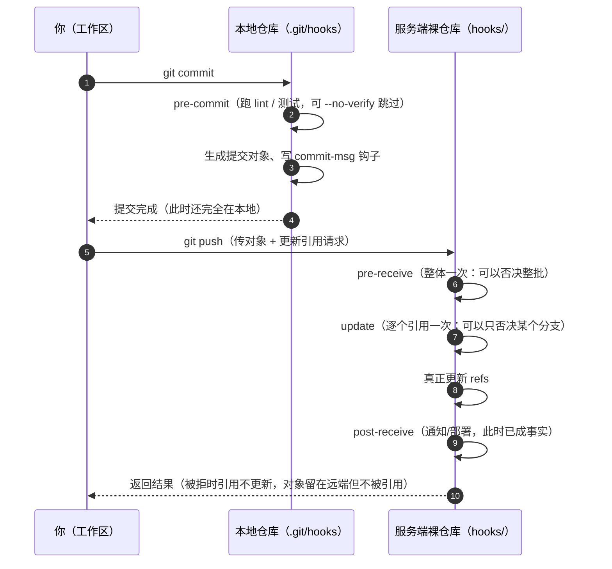
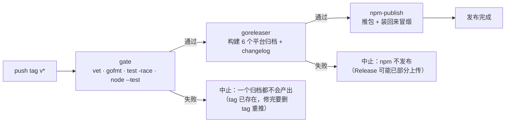

# 第 11 章：钩子、签名与发布

> **本章目标**：搞清"自动化检查该放在哪一层"——本地钩子、服务端钩子、还是 CI？
> 学完你能解释：为什么钩子替代不了 CI、为什么发布要用**签名 tag**、
> 以及 sourcepack 的发布链路为什么长成现在这样（含一次真实事故的复盘）。

---

## 11.1 钩子的机制：就是可执行文件

钩子（hook）是 Git 在特定时机调用的**可执行文件**，默认放在 `.git/hooks/`：

```bash
$ ls .git/hooks | head -4
applypatch-msg.sample
commit-msg.sample
pre-commit.sample          # ← .sample 后缀不会被调用
pre-push.sample
```

**启用方式就是去掉 `.sample` 并给执行权限**（第 3 章：Git 的很多"机制"都是文件系统约定）。

### 实测：一个 pre-commit 拦截

```bash
$ cat .git/hooks/pre-commit
#!/bin/sh
if grep -rn "TODO-FORBIDDEN" --include="*.txt" . >/dev/null 2>&1; then
  echo "❌ pre-commit: 发现禁止的内容 TODO-FORBIDDEN" >&2
  exit 1
fi
$ chmod +x .git/hooks/pre-commit

$ printf 'ok\n' > ok.txt && git add ok.txt && git commit -m "正常提交"
[main abc1234] 正常提交                       # ✅ 通过

$ printf 'TODO-FORBIDDEN\n' > bad.txt && git add bad.txt && git commit -m "坏提交"
❌ pre-commit: 发现禁止的内容 TODO-FORBIDDEN
$ echo $?
1                                             # ✅ 被拦下
```

### 实测：`--no-verify` 可以绕过

```bash
$ git commit --no-verify -m "绕过钩子"
[main 2b2cba1] 绕过钩子                        # ⚠️ 钩子形同虚设
```

### 实测：钩子**不进版本库**

```bash
$ git ls-files .git/hooks | wc -l
0                                             # 克隆不会带走钩子
```

**想让团队共享钩子**，常见做法是把脚本放进仓库并设置路径：

```bash
$ git config core.hooksPath .githooks         # 团队成员各自设置一次
```

---

## 11.2 钩子的位置：客户端 vs 服务端

| 层 | 代表钩子 | 何时跑 | 能否绕过 |
| :--- | :--- | :--- | :--- |
| **客户端**（本地） | `pre-commit`、`commit-msg`、`pre-push`、`pre-rebase` | 你执行对应命令时 | ✅ `--no-verify` / 直接不装 |
| **服务端**（仓库侧） | `pre-receive`、`update`、`post-receive` | 收到推送时 | ❌ 客户端无法绕过 |

**一次提交/推送要过几道闸**（左边三道在你机器上，右边两道在服务器上）：



**读法**：客户端钩子只是"自律"（`--no-verify` 一句话就绕过），
**服务端钩子才是闸**——而且 `pre-receive` / `update` 的区别值得记住：
前者能"一次否决整批推送"，后者能"只否掉其中某个分支"。
`post-receive` 已经无法改变结果，所以它只适合做通知、部署这类副作用。

### 实测：服务端 `pre-receive` 是真正的闸

```bash
# 在裸仓库里放一个钩子
$ cat /tmp/hook-lab-remote.git/hooks/pre-receive
#!/bin/sh
while read oldrev newrev refname; do
  echo "服务端收到推送: $refname" >&2
  if [ "$refname" = "refs/heads/forbidden" ]; then
    echo "❌ pre-receive: 禁止推送 forbidden 分支" >&2
    exit 1
  fi
done
exit 0

$ git push origin allowed
remote: 服务端收到推送: refs/heads/allowed
$ echo $?
0

$ git push origin forbidden
remote: ❌ pre-receive: 禁止推送 forbidden 分支
 ! [remote rejected] forbidden -> forbidden (pre-receive hook declined)
$ echo $?
1

$ git push --no-verify origin forbidden       # 试试绕过
remote: ❌ pre-receive: 禁止推送 forbidden 分支
 ! [remote rejected] ...                       # ← 依然被拒：服务端钩子不理会 --no-verify
```

**这张对照表是本章的核心结论**：

| 需求 | 正确的位置 |
| :--- | :--- |
| 我自己的快速检查（格式化、拼写） | 客户端 `pre-commit`（**可绕过，只当便利**） |
| 团队必须遵守的规范（禁止大文件、密钥扫描） | **CI** 或**服务端钩子**（不可绕过） |
| 保护分支（必须 review / 必须绿） | 托管平台的分支保护规则 |
| 发布前把关 | **CI 的发布闸门**（见 11.4） |

---

## 11.3 签名：证明"这个提交/标签确实是你发的"

Git 支持两种签名（Git ≥ 2.34 起 SSH 签名很常用）：

| 方式 | 配置 | 说明 |
| :--- | :--- | :--- |
| GPG | `user.signingkey=<keyid>` | 传统方式，需要 gpg 与密钥环 |
| **SSH** | `gpg.format=ssh` + `user.signingkey=~/.ssh/id_ed25519.pub` | 复用你已有的 SSH key，**不需要 gpg** |

### 实测：用 SSH key 签提交与 tag（本机没有 gpg，正好演示 SSH 方式）

```bash
$ git config gpg.format ssh
$ git config user.signingkey ~/.ssh/id_ed25519.pub

$ git commit -S -m "签名的提交"
$ git cat-file -p HEAD | sed -n '/^gpgsig/,+2p'
gpgsig -----BEGIN SSH SIGNATURE-----
 U1NIU0lHAAAAAQAAADMAAAALc3NoLWVkMjU1MTkAAAAgR6Nur4hH58/4CmcLlBzmLDQl8c
 GAuNZ4rHTTTirZNHMAAAADZ2aXQAAAAAAAAABzaGE1MTIAAABTAAAAC3NzaC1lZDI1NTE5
```

**验证需要一份"允许签名者"清单**（`gpg.ssh.allowedSignersFile`）：

```bash
$ echo "t@x.c $(cat ~/.ssh/id_ed25519.pub)" > /tmp/allowed_signers
$ git config gpg.ssh.allowedSignersFile /tmp/allowed_signers

$ git verify-commit HEAD
Good "git" signature for t@x.c with ED25519 key SHA256:sS7Y056TZOqIQfVXqPXfjPubt0Qs9+yvTscib7XbLR4
```

**签 tag（发布用）**：

```bash
$ git tag -a -s v9.9.9-test -m "测试签名标签"
$ git tag -v v9.9.9-test
Good "git" signature for t@x.c with ED25519 key SHA256:sS7Y...
$ git cat-file -t v9.9.9-test
tag                                # ← 附注标签是独立对象（第 3 章）
```

**为什么要签发布 tag**：

| 威胁 | 签名的作用 |
| :--- | :--- |
| 账号被盗后发布恶意版本 | 没有你的私钥就签不出有效 tag |
| 中间人替换 tag 指向的提交 | 签名覆盖 tag 对象（含它指向的提交哈希） |
| 下游无法追溯来源 | 用户可 `git tag -v` 自行验证 |

**本仓库的现状（诚实说明）**：`commit.gpgsign` 未设置，提交与 tag **都没有签名**。
对个人项目可接受；一旦涉及分发（npm 包、二进制），
**至少给发布 tag 签名**是低成本高收益的加固。

---

## 11.4 sourcepack 的发布链路

### 触发方式：推 tag

```yaml
# .github/workflows/release.yml
on:
  push:
    tags: ['v*']
```

**为什么用 tag 而不是分支**：第 9 章实测过——**改写历史时 tag 不跟随**，
所以 tag 是稳定的"发布锚点"；分支会动，缓存/引用分支名会失效。

### 三段式流水线（`needs` 串起来）

```
push tag v*  →  gate  →  goreleaser  →  npm-publish(+ 两段冒烟)
                ↓            ↓                  ↓
            全套检查     构建 6 个平台归档    发布 npm 并装回来验证
```

**失败会停在哪一步**（`needs` 的语义就是这个）：



**读法**：闸门在**最前面**——它的存在意义是"宁可一个归档都不产出，也不要把
已知有问题的版本发出去"（11.5 节那个 v1.8.0 事故就是没有这道闸）。
三段之间是**硬依赖**（`needs`），所以任何一段失败，后面都不会跑。

**① `gate`（发布闸门）**：

```yaml
    gate:
      steps:
        - uses: actions/checkout@v4
        - uses: actions/setup-go@v5
          with: { go-version: '1.24.x' }
        - run: go vet ./...
        - name: gofmt
          run: |
            unformatted=$(gofmt -l .)
            if [ -n "$unformatted" ]; then echo "$unformatted"; exit 1; fi
        - run: go test -race ./...
        - run: node --test test/
```

**为什么会有这个 job**：见 11.5 的事故复盘。它的注释里写着原因：

> `v1.8.0 就是"打 tag 直接构建发布"放出去的，当天暴露三个线上可见问题`

**② `goreleaser`（构建与发布归档）**：

```yaml
  goreleaser:
    needs: gate                      # ← 闸门没过就不构建
    permissions: { contents: write } # ← 权限按 job 最小化
    steps:
      - uses: actions/setup-go@v5
        with: { go-version: '1.24.x' }   # ← 固定版本，不用 'stable'
```

`.goreleaser.yaml` 的产物矩阵：

```yaml
builds:
  - env: [CGO_ENABLED=0]
    goos: [linux, darwin, windows]
    goarch: [amd64, arm64]
    main: .
    ldflags: ['-X main.versionStr=v{{.Version}}']    # 版本号注入二进制
archives:
  - name_template: "{{ .ProjectName }}_{{ .Version }}_{{ .Os }}_{{ .Arch }}"
    wrap_in_directory: true
    format_overrides: [{ goos: windows, format: zip }]
checksum: { name_template: 'checksums.txt' }
```

**注意 `{{ .Os }}` 是 Go 的 GOOS（`windows`），不是 Node 的 `win32`**——
第 6 章的命名差异问题**正是这个模板与 npm 安装脚本不一致**造成的，
两个平台名混用直接让 Windows 用户装不上（v1.8.0 事故之一）。

**③ `npm-publish`（发布到 npm + 端到端冒烟）**：

```yaml
        - uses: actions/setup-node@v4
          with:
            registry-url: 'https://registry.npmjs.org'    # ← 官方写法
        - run: npm publish --access public
          env:
            NODE_AUTH_TOKEN: ${{ secrets.NPM_TOKEN }}     # ← 不再 echo token 到 ~/.npmrc
```

然后是**两段冒烟**（这是"发布闸门"的延伸，把验证做到用户路径上）：

| 阶段 | 做什么 | 覆盖什么 |
| :--- | :--- | :--- |
| 冒烟 1/2 | 用包里的 `download-binary.js` 拉**真实 Release 资产**，校验落地名/可执行/`--version`/`-h` | 不依赖 npm registry 传播，确定性最高；正好覆盖 v1.8.0 那类"归档名不一致" |
| 冒烟 2/2 | 轮询等 registry 传播后 `npm i -g`，再跑一遍 | 验证**发布出去的 tarball**（含 postinstall） |

**为什么分两段**：v1.8.2 首次上线时冒烟**因为 npm 传播慢而在 90 秒内一直 `ETARGET` 失败**——
那是脚本设计问题，不是包的问题。现在改成"先做不依赖传播的确定性检查，再做传播后的验证"。

---

## 11.5 事故复盘：v1.8.0 的"打 tag 直接发布"

| 时间 | 事件 |
| :--- | :--- |
| v1.8.0 发布当天 | 三个线上可见问题：**Windows 完全装不上**、`--staged` 计数恒为 0、`-h` 丢失自定义说明 |
| 当天 | 修完发 v1.8.1 |
| v1.8.2 | **补上 `gate` job + 固定 Go 版本 + 权限最小化 + npm 认证现代化 + 两段冒烟** |
| 同批 | CI 矩阵加入 **windows-latest**——加完当天就抓到两个真实平台问题 |

**这条链条的因果很清楚**：

```
发布流程缺闸门  →  问题留到用户手上
缺少 Windows CI →  平台问题根本没机会被发现
缺少安装冒烟    →  "装完即挂"这类问题只能靠用户反馈
```

**修复后的实测收益**（第 4/6 章引用的两件事）：

| 加的检查 | 抓到了什么 |
| :--- | :--- |
| `windows-latest` 矩阵 | `filepath.Match` 在 Windows 让 `*` 跨过 `/`；CRLF 让 `gofmt` 闸门假失败 |
| `go test -race` | 并发/管道问题（我们有 `io.Pipe` 与 goroutine） |
| 两段冒烟 | 归档名/落地名一致性（v1.8.0 的 Windows 事故） |

> **对你自己项目的启示**：发布前至少跑一遍"**用户实际会走的那条路**"
> （装包 → 跑命令 → 看输出），而不只是跑单元测试。
> v1.8.0 的三个问题里，有两个（Windows 安装、`-h`）都能被一条安装冒烟拦住。

---

## 11.6 发布史：42 个 tag 与"附注 tag 就是发布说明"

```bash
$ git tag -l 'v*' | wc -l
42
$ git for-each-ref --sort=creatordate --format='%(refname:short) %(creatordate:short) %(subject)' refs/tags | tail -4
v1.8.2 2026-10-12 v1.8.2: 中文大文件误判二进制（P0）、diff 路径解析、输出目的地互斥、.env 模板、发布闸门与 Windows CI
v1.9.0 2026-10-12 v1.9.0: 忽略匹配器按 git 语义重写（**/!/目录规则/嵌套 .gitignore，与 git check-ignore 逐条对齐）
v2.0.0 2026-10-12 v2.0.0: -d 非法路径明确报错（行为变更）；-h 新增 Examples 示例段；参数手册 PARAMETERS.md
v2.0.1 2026-10-12 v2.0.1: -h 末尾换成参数手册博客版（https://s.want.biz/sourcepack）
```

**注意第三列**：`%(subject)` 取的是 **tag 对象的说明**（第 3 章：附注标签是独立对象）。
所以 `git tag -a -m "..."` 写的那段话，就是**发布说明**——
`git tag -l` 看不到它，`git for-each-ref`/`git show <tag>` 才能。

> ⚠️ **但这条只对附注 tag 成立。** 上面的例子看着整齐，是因为那 4 个恰好都是附注 tag。
> 本仓库 42 个 tag 里只有 **12 个是附注对象**，另 30 个是轻量 tag——
> 对轻量 tag，`%(subject)` 会退回去显示**它指向的那个 commit 的标题**，
> 看起来也像"说明"，但那是提交信息、不是发布说明，而且**没有地方能放说明、也无法签名**。
> 想区分，用 `git cat-file -t <tag>`：附注返回 `tag`，轻量返回 `commit`。

**这也是为什么发布要用 `-a`（附注）而不是轻量 tag**：
轻量 tag 只是一个指向 commit 的引用，**没有地方放发布说明**，也无法签名。

---

## 11.7 回到 sourcepack：我们没有钩子，CI 就是我们的钩子

**实测现状**：

```bash
$ ls .git/hooks | grep -v '\.sample$' | wc -l
0
$ git config core.hooksPath || echo "(未设置)"
(未设置)
```

**为什么没有钩子**（有意的设计）：

| 原因 | 说明 |
| :--- | :--- |
| 钩子是**本地**的 | 克隆不带走（11.1 实测），团队规范必须放到 CI |
| 钩子**可绕过** | `--no-verify` 一句话失效 |
| 我们的质量闸门在**发布链路**里 | `gate` job + windows 矩阵 + 两段冒烟（11.4），这些谁都绕不过 |
| 工具本身**不该改仓库** | sourcepack 是只读工具（第 9 章）；给它装钩子等于污染用户仓库 |

**"我们的钩子"= CI 矩阵 + 发布闸门**，对应关系：

| 传统钩子 | sourcepack 的做法 |
| :--- | :--- |
| `pre-commit`（格式化/静态检查） | CI 里的 `go vet` + `gofmt -l`（**不可绕过**） |
| `pre-push`（跑测试） | CI 里的 `go test -race ./...` + `node --test test/` |
| 服务端 `pre-receive`（禁止坏提交） | 发布闸门 `gate` + 分支保护 |
| 发布后验证 | **两段式冒烟**（钩子做不到这一层） |

---

## 11.8 动手实验 `[lab]`

```bash
# A. 客户端钩子与它的边界
rm -rf /tmp/l11 && mkdir /tmp/l11 && cd /tmp/l11 && git init -q -b main . \
  && git config user.email t@t.c && git config user.name T
cat > .git/hooks/pre-commit <<'EOF'
#!/bin/sh
if grep -rn "FORBIDDEN" . --include="*.txt" >/dev/null 2>&1; then echo "❌ 拦截" >&2; exit 1; fi
EOF
chmod +x .git/hooks/pre-commit
printf 'ok\n' > ok.txt && git add ok.txt && git commit -m ok          # 通过
printf 'FORBIDDEN\n' > bad.txt && git add bad.txt && git commit -m bad ; echo "退出码 $?"   # 被拦
git commit --no-verify -m bypass ; git log --oneline -1              # 绕过成功
git ls-files .git/hooks | wc -l                                      # 0：不进版本库

# B. 服务端钩子（不可绕过）
git init -q --bare /tmp/l11-remote.git
cat > /tmp/l11-remote.git/hooks/pre-receive <<'EOF'
#!/bin/sh
while read o n ref; do
  case "$ref" in *forbidden*) echo "❌ 服务端禁止 $ref" >&2; exit 1;; esac
done
EOF
chmod +x /tmp/l11-remote.git/hooks/pre-receive
git remote add origin /tmp/l11-remote.git
git push origin main
git push --no-verify origin main:forbidden ; echo "退出码 $?"        # 仍被拒

# C. SSH 签名（本机无 gpg 也能做）
git config gpg.format ssh && git config user.signingkey ~/.ssh/id_ed25519.pub
git commit -S --allow-empty -m "签名提交"
git cat-file -p HEAD | head -5                                        # 看 gpgsig 段
echo "t@x.c $(cat ~/.ssh/id_ed25519.pub)" > /tmp/allowed_signers
git config gpg.ssh.allowedSignersFile /tmp/allowed_signers
git verify-commit HEAD
git tag -a -s v0.0.1-test -m "签名标签" && git tag -v v0.0.1-test

# D. 看自己项目的发布链路
cat .github/workflows/release.yml          # 或你项目的等价物
git tag -l 'v*' | wc -l
git for-each-ref --sort=creatordate --format='%(refname:short) %(subject)' refs/tags | tail -5
```

**自测题**：

1. 客户端钩子与服务端钩子，哪个 `--no-verify` 能绕过？为什么？
2. 为什么"团队规范"不能只靠 `pre-commit`？给出两条理由。
3. SSH 签名与 GPG 签名各有什么取舍？验证签名需要什么额外文件？
4. 为什么发布要用**附注 tag** 而不是轻量 tag？（提示：发布说明放在哪）
5. `.goreleaser.yaml` 的 `{{ .Os }}` 与 Node 的 `os.platform()` 有什么区别？这个区别在 v1.8.0 造成了什么后果？
6. sourcepack 的发布链路有哪三段？每段拦住什么类型的问题？

<details>
<summary>点开看答案</summary>

1. **只有客户端钩子能绕过，服务端钩子不能**。`--no-verify` 是 git 命令行的本地
   开关，git 在执行 `pre-commit`/`commit-msg`/`pre-push` 时会检查它并跳过，
   所以本地钩子形同虚设（11.1 实测：坏提交退出码 1，加 `--no-verify` 后 0）。
   服务端钩子跑在远端仓库自己的 git 进程里，你的命令行开关根本传不过去，
   因此 `git push --no-verify origin forbidden` 依然得到
   `! [remote rejected] … (pre-receive hook declined)`（11.2 实测）。

2. **① 钩子不进版本库**：`git ls-files .git/hooks` 恒为 0，克隆不会带走，
   新人 clone 后等于没装；`core.hooksPath .githooks` 也要每人各自设置一次（11.1）。
   **② 它可以被一句 `--no-verify` 绕过**，无法强制（11.1 实测）。
   所以"团队必须遵守的规范"（禁大文件、密钥扫描）应放在 CI 或服务端钩子，
   见 11.2 的对照表；sourcepack 自己就是"不装钩子、闸门放 CI"（11.7）。

3. **SSH 复用已有的 SSH key、不需要 gpg 与密钥环；GPG 的生态更久、老平台支持更全**。
   配置差异：GPG 用 `user.signingkey=<keyid>`；SSH 要 `gpg.format=ssh` +
   `user.signingkey=~/.ssh/id_ed25519.pub`（11.3 表）。两者验证都额外需要一份
   "允许签名者"清单，SSH 侧是 `gpg.ssh.allowedSignersFile`（格式 `身份 <公钥>`，
   如 `t@x.c ssh-ed25519 AAAA…`）。实测：缺这个文件时 git 仍报签名本身有效
   （`Good "git" signature`），但无法把签名归到某个 principal
   （`Unable to open allowed keys file`）。命令：`git verify-commit HEAD`、
   `git tag -v <tag>`。

4. **因为只有附注 tag 有地方放发布说明，也只有它能签名**。轻量 tag 只是一个指向
   commit 的引用；`git tag -a -m "…"` 写的那段话存在独立的 tag 对象里
   （`git cat-file -t` 返回 `tag`，见 11.3 实测），只有 `git for-each-ref` 的
   `%(subject)` 与 `git show <tag>` 取得到，`git tag -l` 看不到它（11.6）。
   签名同理——`git tag -a -s` 需要有一个对象可签。所以发布锚点必须是附注 tag：
   本仓库 42 个 tag 里，12 个是附注对象、30 个是轻量 tag，第三列能显示说明的正是前者。

5. **`{{ .Os }}` 是 Go 的 GOOS（Windows 上是 `windows`），Node 的 `os.platform()`
   返回 `win32`，不映射就会拼出错误的归档名去 404**。`.goreleaser.yaml` 的
   `name_template` 决定归档名（`sourcepack_<版本>_windows_amd64.zip`），而
   `download-binary.js` 用 `os.platform()` 拼下载 URL，所以代码里必须显式映射
   `win32 → windows`（`resolveTarget` 里 `const goos = isWindows ? 'windows' : platform`；
   `os.arch()` 的 `x64` 与 GOARCH 的 `amd64` 也要过 `archMap`）。
   v1.8.0 缺这层对齐，后果是 **Windows 用户完全装不上**（11.4/11.5 的事故一）。

6. **三段：`gate` → `goreleaser` → `npm-publish`，用 `needs` 串联（11.4）**。
   **① `gate`**：`go vet ./...` + `gofmt -l .` + `go test -race ./...` +
   `node --test test/`，拦静态检查、格式化、并发与单元级问题——它的注释里直接
   写着这个 job 就是为 v1.8.0 事故加的。
   **② `goreleaser`**（`needs: gate`）：构建 3 OS × 2 架构共 6 个平台的归档并传
   Release，拦"闸门没过就构建发布"，同时固定 `go-version: '1.24.x'` 保证产物可复现。
   **③ `npm-publish`**（`needs: goreleaser`）：发 npm 后跑两段冒烟——1/2 用包里的
   `download-binary.js` 拉真实 Release 资产（不依赖 registry 传播，拦归档名/落地名
   不一致，正是 v1.8.0 的 Windows 问题）；2/2 轮询等传播后 `npm i -g` 再验一遍，
   拦发布出去的 tarball 与 postinstall 问题。

</details>

---

## 11.9 小结

- **钩子就是可执行文件**（`.git/hooks/`），启用＝去 `.sample` + 加执行权限；
- **客户端钩子可被 `--no-verify` 绕过、不进版本库**（克隆不带走）→ 只能当**便利**；
  **服务端钩子不可绕过**（实测 `! [remote rejected] (pre-receive hook declined)`）；
  团队规范应放在 **CI / 服务端 / 分支保护**；
- **签名**可以用 SSH（`gpg.format=ssh`，不需要 gpg）：实测 `gpgsig` 段落、
  `git verify-commit` / `git tag -v` 输出 `Good "git" signature`；
  验证需要 `allowedSignersFile`；**发布 tag 应当签名**（本仓库当前未签名，属已知短板）；
- sourcepack 的发布链路：**推 tag → gate（vet/gofmt/race/node）→ goreleaser（6 平台归档）
  → npm publish → 两段冒烟**；每段都用 `needs` 串起来，权限按 job 最小化；
- **发布用 tag 不用分支**：tag 不跟随历史改写（第 9 章实测），是稳定锚点；
  **附注 tag 自带发布说明**（42 个 tag 里 12 个是附注对象，第三列显示的正是它们）；
- **v1.8.0 事故的教训**：没有闸门、没有 Windows CI、没有安装冒烟，
  三个线上问题因此漏出——修复后同批加的 windows 矩阵当天就抓到两个真实平台 bug；
- sourcepack **有意不装钩子**：钩子本地/可绕过/会污染用户仓库，
  我们的闸门在 CI 与发布链路上。

**下一章（最后一章）**：把前 11 章的结论收拢回代码——
`gitRunner` 的每一条 hardening 对应本章/前章的哪个坑、`-z` 解析为什么必需、
`--src-prefix` 与 `--no-textconv` 防的是什么、只读命令清单，
以及"我们的测试夹具为什么要自己合成合并提交、中文路径与坏 textconv"。
