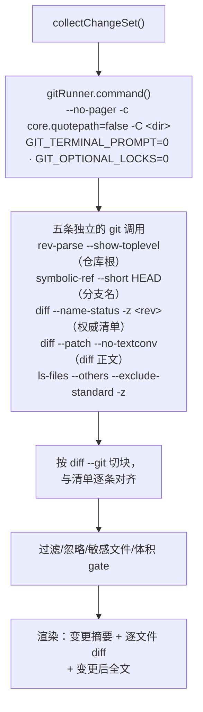

# 第 12 章：sourcepack 的 Git 用法全解（结课）

> **本章目标**：把前 11 章的结论**逐条落回代码**。学完之后，你不仅能读 Git 的原理，
> 还能自己写一个"安全地读 Git"的工具——本章最后一节给出可直接照抄的 checklist。
>
> 这一章也是全课的收束：每一个 hardening 细节，都能指回某一章讲过的坑。

---

## 12.1 全景：我们与 Git 的接口只有一层

整个项目对 Git 的依赖被收在一层薄封装 `gitRunner` 里——结构体本身只有 **2 个字段**
（`changeset.go` 的 `type gitRunner struct`，本版 157 行起）：

```go
type gitRunner struct {
	dir      string
	pathspec string // 仓库根相对路径，"" 表示整个仓库
}
```

真正做事的不是这个结构体，而是挂在它上面的几个方法，且**所有 git 调用都必须经过
`command()`**——hardening 只写在这一处：

```
   ┌──────────────────────────────────────────────┐
   │  sourcepack                                  │
   │   collectChangeSet()  →  gitRunner           │
   │                          ├── command()        │  ← 所有 hardening 在这里
   │                          ├── run()            │
   │                          └── runLimited()     │  ← 带字节上限的读取
   └───────────────┬──────────────────────────────┘
                   │  exec.Command("git", ...)
                   ▼
             真正的 git 可执行文件
```

**为什么要收成一层**：只要所有调用都经过 `command()`，
加固措施就**不可能被漏掉**（新增调用自动继承）。这和后端服务里"所有出站请求走同一个 client"是同一个道理。

**一次 `-g`（未提交改动）从命令到产物，数据是怎么流的**：



**读法**：左边一列是**五条独立的 git 调用**——sourcepack 不去"推导"状态，
而是**问 git 要权威答案**（`-z` 防路径含空格/换行、`--no-textconv` 防用户配置
让 diff 失败，见 12.5）。中间那一步"把 patch 贴回清单"是全书最脏的地方：
patch 的路径可能被前缀改写，而清单是权威（第 6 章 6.11 节的四处硬骨头）。

```go
func (g *gitRunner) command(args ...string) *exec.Cmd {
	full := make([]string, 0, len(args)+5)
	full = append(full, "--no-pager", "-c", "core.quotepath=false", "-C", g.dir)
	full = append(full, args...)
	cmd := exec.Command("git", full...)
	cmd.Env = append(os.Environ(),
		"GIT_PAGER=cat",
		"GIT_TERMINAL_PROMPT=0",
		"GIT_OPTIONAL_LOCKS=0",
	)
	cmd.Stdin = nil // 防止 git 去读 stdin 而挂住
	return cmd
}
```

---

## 12.2 每一条 hardening 对应哪一章的哪个坑

| 措施 | 没有它会怎样 | 对应章节 |
| :--- | :--- | :--- |
| `--no-pager` + `GIT_PAGER=cat` | `git log` 在非 TTY 环境下启动分页器，**进程挂住直到超时** | 第 1 章（git 调用细节） |
| `cmd.Stdin = nil` | git 尝试读 stdin（例如等待 `--edit` 或凭据），**永久阻塞** | 第 1 章 |
| `GIT_TERMINAL_PROMPT=0` | 需要认证时弹出提示，CI/agent 里**挂死**（宁可失败） | 第 8 章（协议与认证） |
| `GIT_OPTIONAL_LOCKS=0` | 只读操作去抢 `.git/index.lock`，与用户并发操作**互相干扰** | 第 4 章（索引） |
| `-c core.quotepath=false` | 中文文件名被转义成 `\344\275\240`，**路径解析全错** | 第 2/6 章（对象与 patch 格式） |
| `-C <dir>` | 需要 `os.Chdir`（进程级全局状态），并发/测试都不安全 | 第 1 章 |
| 把 stderr 包进 error | 用户看到 `exit status 128` 而**不知道 git 说了什么** | 第 1 章（"报错就是 git 的报错"） |
| `runLimited(limit, ...)` | 病态 diff（单行 20MB）把内存吃穿 | 第 6 章 + 第 10 章（体积上限） |

**注意最后一行的实现细节**：`runLimited` 用 `StdoutPipe` 流式读取并**在超限后继续排干管道**
（否则 git 会因写端阻塞而卡住）——这是"读子进程输出"的经典坑：

```go
	data, readErr := io.ReadAll(io.LimitReader(stdout, int64(limit)+1))
	clipped := len(data) > limit
	if clipped {
		data = data[:limit]
	}
	// 必须把剩余输出排干，否则子进程可能阻塞在写管道上导致 Wait 挂死。
	_, _ = io.Copy(io.Discard, stdout)
	waitErr := cmd.Wait()
```

**还有一条同样重要**：截断后**不能吞掉 `waitErr`**——因为管道已经排干，
此刻的失败一定是 git 自己出错（而不是"我们不读了导致它 SIGPIPE"）：

```go
	if waitErr != nil {
		// clipped 时同样要报错：上面已经把管道排干……
		return string(data), clipped, fmt.Errorf("git %s failed: %s", ...)
	}
```

> 这个细节曾经**真的错过**（截断时用 `if waitErr != nil && !clipped` 静默吞掉了失败），
> 修法与反向验证见第 12.7 节。

---

## 12.3 完整命令清单（我们到底调了哪些 git）

**只读命令一览**（生产代码，`changeset.go` + `changeoutput.go`）：

| 用途 | 完整参数（省略公共前缀） | 对应章节 |
| :--- | :--- | :--- |
| 找仓库根 | `rev-parse --show-toplevel` | 第 3 章（引用/工作区定位） |
| 处理 `-d 子目录` | `rev-parse --show-prefix` | 第 5 章（作用域） |
| 取分支名 | `symbolic-ref --short HEAD` | 第 3 章（符号引用；detached 会失败） |
| 取提交 | `rev-parse HEAD` / `rev-parse --short HEAD` | 第 2/3 章 |
| 取标题 | `log -1 --format=%s` | 第 2 章（commit 字段） |
| 校验 `--rev` | `rev-parse --verify <base>^{commit}` | 第 3 章（剥壳） |
| 算共同祖先（`--base`） | `merge-base <base> HEAD` | 第 5 章（merge-base 的算法） |
| 变更清单 | `diff --no-ext-diff --name-status -z -M [--cached] [base] [-- pathspec]` | 第 4/6 章 |
| 暂存集合 | `diff --no-ext-diff --name-status -z -M --cached <base>` | 第 4 章（索引） |
| 未暂存集合 | `diff --no-ext-diff --name-status -z -M` | 第 4 章 |
| 未跟踪文件 | `ls-files --others --exclude-standard --full-name -z` | 第 7 章（忽略规则） |
| patch 正文 | `diff --no-ext-diff --no-textconv --no-color -M --src-prefix=a/ --dst-prefix=b/ [base]` | 第 6 章 |
| 提交遍历 | `log -N --date=short --format=%H<sep>%h<sep>%an<sep>%ad<sep>%P<sep>%s [--no-merges]` | 第 5 章（%P = 父边） |

**⚠️ 一个必须自己控制的细节**：`--format` 里我们用的分隔符是
**ASCII 的 Unit Separator（0x1F）**，而不是空格、逗号或 `|`：

```go
	logFieldSep = "\x1f"
	// 用法：
	"--format=%H" + logFieldSep + "%h" + logFieldSep + "%an" + logFieldSep +
	"%ad" + logFieldSep + "%P" + logFieldSep + "%s"
```

**为什么**：作者名与提交信息里**什么都可能出现**（含 `|`、含逗号、含换行），
但 0x1F 是"不可打印的控制字符"，实际提交信息里不会出现。
这与"清单一律用 `-z`"是同一条原则：

> **永远不要用可能出现在数据里的分隔符。** 要么用 NUL（`-z`），
> 要么用控制字符（0x1F），要么写个真正的解析器——绝不用空格/逗号/`|`。

---

## 12.4 为什么必须 `-z`：一个实测过的坑

`git diff --name-status` 的默认输出是**按行**的：

```
M	src/app.go
R100	src/old name.go	src/new name.go      # ← 制表符分隔，路径含空格
```

**问题**：路径里可以出现**空格、制表符、换行、引号**（Git 允许），
所以"按行 + 按空白切分"必然在某些仓库上崩掉。

`-z` 改成 **NUL 分隔**（NUL 是路径里唯一不可能出现的字节），于是解析变成：

```go
func parseNameStatusZ(s string) ([]*Change, error) {
	fields := strings.Split(s, "\x00")
	...
}
```

**测试里专门钉住了这些情形**（`changeset_test.go`）：

```go
"D\x00gone.md\x00C75\x00base.go\x00copy.go\x00M\x00中文 文档.md\x00"   // 中文 + 空格
{"a/hello world.txt\t": "hello world.txt"},        // git 给含空格路径加的尾 TAB
{"b/中文 文档.md\t":      "中文 文档.md"},
```

> **这里有一个真实修过的"死通道"**：`parseNameStatusZ` 起初签名里带 `error`，
> 但内部**永远不会返回非 nil**（畸形输入被静默当成正常数据）。
> 后果是"-z 输出被破坏时，我们既不报错也不丢弃，而是拿着垃圾继续跑"。
> 修法是让它真的校验（包括改名条目里空路径这种情形）并返回 error，
> 由调用方 `collectChangeSet` 抛出——**能被静默忽略的错误通道，等于没有错误处理**。

---

## 12.5 diff 相关的三个防御（每一个都有实测支撑）

| 参数 | 防的是什么 | 实测证据（哪一章） |
| :--- | :--- | :--- |
| **`--no-textconv`** | 用户配的 textconv 命令**改写 diff**，甚至让 `git diff` 直接失败 | 第 6 章：用户 textconv 失败时 `git diff` 退出码 **128**，而 `gx -g` 照常 exit 0 |
| **`--no-ext-diff`** | 用户配的**外部 diff 程序**（`diff.external`）会产生任意格式，我们的解析器必然错 | 第 6 章 |
| **`--src-prefix=a/ --dst-prefix=b/`** | `diff.mnemonicPrefix`（`i/`/`w/`）与 `diff.noprefix` 会改变头部，**路径还原不出来** → 幽灵条目 | 第 6 章：v1.8.1 出现假变更 `c/b/gone.go`，v1.8.2 修复 |
| **`-M`** | 不传则重命名显示为"删除+新增"（`A`+`D`），审查价值大幅下降 | 第 6 章：`R094` vs `A`/`D` 实测 |

**共同点**：这四条都是"**不去猜用户配置，而是把协议固定下来**"。
这是写工具时最重要的心态之一——**用户的配置是环境的一部分，不是你的接口**。

---

## 12.6 只读保证：实测我们能证明什么

```bash
$ grep -oE '"(diff|log|ls-files|rev-parse|symbolic-ref)"' changeset.go | sort -u | tr '\n' ' '
"diff" "log" "ls-files" "rev-parse" "symbolic-ref"
# 上面这条正则故意只抓"无条件走"的路径；再补一条，看 --base 分支：
$ grep -n 'g\.run("merge-base"' changeset.go
328:		mb, mbErr := g.run("merge-base", config.GitBase, "HEAD")
```

**默认路径五种子命令；启用 `--base` 时是第 6 个：`merge-base <base> HEAD`**
（`changeset.go:328`）。六条**全都是只读命令**，`merge-base` 只算共同祖先、
不写对象库也不动引用，所以"只读"的结论不变，只是计数随参数变化。

> 记这个细节是为了说明一件方法论上的事：**用 grep 做"我们只调用了什么"的审计时，
> 正则本身就是结论的一部分**。上面第一条正则排除了 `merge-base`，
> 因为它在条件分支里；如果照搬它的输出说"我们只用五条命令"，
> 就漏了第六条。写这类自查时，要么把分支也 grep 一遍，要么把口径写清楚。

这带来三个可验证的性质：

| 性质 | 为什么重要 |
| :--- | :--- |
| **零副作用** | 可以在任何仓库里跑，不需要备份、不会改索引/引用 |
| **不需要权限** | 只读 check-out 也能用（CI、agent 沙箱） |
| **可并发** | 不抢 `index.lock`（配合 `GIT_OPTIONAL_LOCKS=0`） |

---

## 12.7 测试策略：三种"以真值为准"的做法

这是全课最值得带走的部分——**我们怎么证明"我们理解对了 Git"**。

### ① 以 git 自己为真值（差分测试）

`ignore_test.go` 用 **14 个模式 × 40 条路径**逐条对照 `git check-ignore`：

```go
var oraclePatterns = []string{
	"*.log", "**/*.log", "**/*.tmp", "src/**/*.go", "**/node_modules",
	"a/**/b", "abc/**", "build/", "/rooted.txt", "docs/**/*.md",
	"*.min.js", "temp?", "[ab]racket.txt", "keep/**/deep.txt",
}
```

**为什么强**：模式的组合空间（锚定 × `**` 位置 × 目录规则 × 负向）无法靠"想用例"覆盖；
把判定权交给 git，我们的任务就从"想全边界"变成"对齐一个已有实现"。
**第一次跑就抓到了 `a/**/b` 之下 `a/b/c` 的父目录规则**（第 7 章）。

### ② 夹具合成"真实仓库里没有的形态"

第 5 章发现：**sourcepack 自己的提交历史里一个合并都没有**（写作时自查 `--merges` = 0）。
所以合并相关的代码路径只能靠夹具合成：

| 要覆盖的形态 | 夹具怎么造 | 对应章节 |
| :--- | :--- | :--- |
| 合并提交（两条父边） | `git checkout -b feat` + 两边各提交 + `git merge --no-ff` | 第 5 章 |
| 改名/删除/复制 | `git mv` + `git rm` + 内容微调（触发 `-M` 相似度） | 第 2/6 章 |
| 中文/空格/含 TAB 路径 | 文件名直接用中文与空格，断言用 `-z` 解析结果 | 第 12.4 |
| 坏 textconv | `.gitattributes` + `diff.<d>.textconv` 配一个会失败的命令 | 第 6 章 |
| 无提交仓库（unborn HEAD） | `git init` + 不提交 | 第 3 章 |
| detached HEAD | `git checkout --detach` | 第 3 章 |
| 跨 32KB 块的中文文件 | 直接写 183KB 中文+ASCII 文件 | 第 2 章（P0 bug） |

### ③ 反向验证（Mutation Testing 的手工版）

**改完 bug 就把修复改回错误实现，确认测试真的变红**。本仓库的关键修复都做过：

| 反向改动 | 失败的用例 |
| :--- | :--- |
| 不标 `--staged` | `StagedCount = 0，期望 3` |
| 截断时吞掉 git 失败 | `截断时 git 失败仍必须报错` |
| 不挂包级 `pflag.Usage` | `-h 输出缺少 "Convenience shortcuts:"` |
| `DiffFull` 放回二进制检查之前 | `含裸字节的 diff 应丢弃且 DiffFull=0` |
| carry 拼接写回错误形式 | `中文注释+ASCII(chunk=2): isBinary=true，期望 false` |
| `printUsage` 恢复成默认输出 | `应恢复调用者原来的输出目标` |

**为什么必要**：不做这一步，你无法区分"测试通过"与"测试根本没跑到"。
**我自己就因为漏做而误判过一次**（补丁没打上却以为测试没覆盖），
所以后来固定成流程。

**规模**：Go **79 个用例 / 5 个文件** + Node **6 个用例**，CI 跑 3 OS × 3 Go 版本。

> 用例数会随开发增长（写作时是 79）。自查请用
> `grep -rn "^func Test" *_test.go | grep -iv TestMain | wc -l`，别照抄书里的数字。

---

## 12.8 我们**没有**做的事（以及为什么）

| 没做 | 理由 | 章节 |
| :--- | :--- | :--- |
| 不引 go-git | 体积、`autocrlf`/filter/`.gitattributes` 的真实行为、报错可解释 | 第 1 章 |
| 不自己解析 revspec | 规则极多，交给 `rev-parse` + 包装报错 | 第 3 章 |
| 不自己实现 ignore 语义（除了 `.gdignore`） | git 模式由 git 给清单；`.gdignore` 是我们的机制才需要自实现 | 第 7 章 |
| 不改写历史 | 只读工具，零副作用 | 第 9 章 |
| 不动 repo 级优化（commit-graph/bitmap/repack） | 那是仓库所有者的选择 | 第 10 章 |
| 不装钩子 | 本地、可绕过、会污染用户仓库；闸门放 CI | 第 11 章 |
| 不做"自动拆分产物" | 按 token 装箱会把模块切碎，价值/复杂度不划算（已记 TODO） | — |

**这七条有一个共同点**：**先问"这件事该由谁负责"，再决定要不要自己实现**。
Git 已经负责的部分（对象、引用、合并、忽略、传输），我们只读不重写；
只有 Sourcepack 独有的概念（`.gdignore`、产物排版、变更集过滤）才自己实现。

> 上面说的是"sourcepack **没有做**什么"。如果你想知道"这本书**没有讲**什么"，
> 看 **[附录 E：进阶主题地图](#附录-e进阶主题地图没写进书里的那-60)**——
> 那里按主题列了 submodule/LFS/worktree/rerere/bisect/邮件补丁/合并策略/
> 协议演进等未覆盖内容，每条都给出"本质 + 用哪一章推理 + 已验证的文档入口"。

---

## 12.9 结课 checklist：写"读 Git"的工具时照抄这 12 条

1. **所有 git 调用走一个封装**（`command()`），加固才不会被漏掉；
2. **禁分页、禁交互、禁 stdin、禁锁**：`--no-pager`、`GIT_PAGER=cat`、
   `GIT_TERMINAL_PROMPT=0`、`Stdin=nil`、`GIT_OPTIONAL_LOCKS=0`；
3. **`-c core.quotepath=false`**，否则中文路径变八进制转义；
4. **一切清单用 `-z`**；自定义字段用不可能出现的分隔符（别用空格/`|`）；
5. **固定协议、不猜配置**：`--src-prefix/--dst-prefix`、`--no-textconv`、`--no-ext-diff`；
6. **路径解析只剥一层前缀**（`a/` / `b/`），并记住仓库里可能真有 `b/` 目录；
7. **别用 `filepath.Match` 处理 `/` 分隔路径**（Windows 上它会跨过 `/`）；
8. **`-M` 才有重命名**，但要意识到它做内容相似度比较（大重构会变慢）；
9. **给子进程输出设体积上限**，并在截断后**排干管道**；
10. **只读命令清单化**，并在文档里承诺"不动仓库"；
11. **合并提交取第一父**，且把口径写进产物（用户才知道你在说什么）；
12. **以 git 为真值做差分测试 + 反向验证**，别只写"我想得到的用例"。

> **这 12 条有可运行版本**：**[附录 F：把 checklist 跑起来](#附录-f把-checklist-跑起来一个-130-行的读-git工具)**
> 是一个约 130 行、零依赖、只读的 Python 小工具 `book/tools/minigx.py`——
> 每个加固都标了它对应上面第几条，并配一个**可复跑的差分自测**
> （`minigx_selftest.py`，造一个含中文名 / `b/` 目录 / 重命名 / 合并提交的真实仓库，
> 用 `git status --porcelain` 当标准答案逐项比对）。
> 想验证"这些加固到底有没有用"，最快的办法是**把它改坏**——附录 F.6 给了三个实验。

---

## 12.10 全课知识地图

```
第 1 章  设计哲学：快照 / 内容寻址 / 三棵树 ─────────────┐
                                                        │
第 2 章  对象模型：blob tree commit tag 的字节与哈希 ───┤
   ├─→ 空树 4b825dc… ────────► 用于"根提交/无提交"的 diff 基准
   └─→ blob 无文件名 ───────► 重命名免费、rename 靠 -M（第 6 章）
                                                        │
第 3 章  引用与 reflog：分支=41 字节 ───────────────────┤
   ├─→ detached HEAD ───────► symbolic-ref 失败的分支回退
   └─→ reflog ─────────────► 第 9 章的救援基础
                                                        │
第 4 章  索引：三棵树中间那棵 ─────────────────────────┤
   ├─→ staged/unstaged 两条边 ► 我们的三个计数
   └─→ stat 缓存 ───────────► 第 10 章的性能
                                                        │
第 5 章  提交图：DAG / 两条父边 / merge-base ──────────┤
   └─→ A..B vs A...B ───────► PR 审查口径（--base 的依据）
                                                        │
第 6 章  diff 与 patch：用时算 ─────────────────────────┤
   ├─→ 前缀可被配置改写 ────► --src-prefix 的由来
   └─→ textconv 会改/坏 diff ► --no-textconv 的由来
                                                        │
第 7 章  忽略规则：只管未跟踪 ─────────────────────────┤
   └─→ 父目录被排除不可救 ───► git 模式必须回溯祖先
                                                        │
第 8 章  远端与传输：增量 packfile ────────────────────┤
   └─→ 非快进保护 / force-with-lease
                                                        │
第 9 章  改写与恢复：造新对象 + 移动引用 ──────────────┤
   └─→ tag 不跟随改写 ──────► 发布锚点用 tag（第 11 章）
                                                        │
第 10 章 性能：delta / commit-graph / bitmap / partial ─┤
                                                        │
第 11 章 钩子 / 签名 / 发布链路 ───────────────────────┤
                                                        ▼
                                        第 12 章 收束回代码：
                                        gitRunner 的每条 hardening、
                                        命令清单、测试策略、checklist
```

---

## 12.11 自测题（综合）

1. 一个用户报告"我的中文文件名在快照里变成了乱码"，你会先查哪一层的哪个参数？
   （提示：第 12.2 与 12.4）
2. 产物里出现了两条一模一样的路径，其中一条是 `c/b/x.go`。可能是什么原因？
   （提示：第 6 章 mnemonicPrefix + 双剥前缀）
3. 用户说"我用 `-g --rev main` 审查我的分支，结果多出一个删除"。怎么解释、怎么建议？
   （提示：第 5 章双点/三点）
4. 为什么我们对 `git log --format` 用自定义分隔符，而不是空格？（第 12.3）
5. 如果要把 sourcepack 改成"同时支持 SVN 仓库"，`gitRunner` 这一层给你什么好处、
   又会有什么代价？（开放题）
6. 从 12.9 的 12 条里挑三条，说明它们各自对应前 11 章的哪个坑。

<details>
<summary>点开看答案</summary>

1. **先查 `gitRunner.command()` 里注入的 `-c core.quotepath=false` 这一层**
   （12.2 表里"没有它会路径解析全错"的那一行）。实测未设置时
   `git diff --name-status` 输出 `"\344\270\255\346\226\207 …"` 八进制转义，
   加上这个参数后是原样 UTF-8。`-c` 优先于用户的 `core.quotepath`，所以日志里
   出现 `\3xx` 基本等于某条 git 调用绕过了 `command()`（12.1）。
   然后是第二层：`parseDiffPath`/`unquoteGitPath` 对引号路径的还原（12.4）——
   中文在 `quotepath=false` 下不会被加引号，与 `--src-prefix/--dst-prefix`
   造成的路径问题（12.5）是两件事，别混。

2. **这是"前缀没固定 + 路径剥了两层"产生的幽灵条目**：`c/b/x.go` 里的 `c/` 是
   `diff.mnemonicPrefix` 的 commit 前缀，`b/` 是仓库里真实存在的目录名。实测仓库里
   有 `b/x.go` 且用户开了 `diff.mnemonicPrefix=true` 时，`git diff HEAD` 的头部正是
   `--- c/b/x.go`；解析器若把 `c/`、`b/` 都当 git 前缀剥掉就得到 `x.go`，与
   `--name-status -z` 给出的 `b/x.go` 对不上，于是同一条路径出现两次。
   修法两条一起上：`command()` 显式传 `--src-prefix=a/ --dst-prefix=b/` 固定协议
   （12.5），`parseDiffPath` 只剥一层、且只剥与本行匹配的那个 `a/` 或 `b/`
   （12.4、12.9 第 6 条）。这就是 v1.8.1 的假变更 `c/b/gone.go`，v1.8.2 修掉。

3. **`--rev` 是双点语义（直接和 main 尖端比），会把"main 有、你分支没有"的提交
   反向算成删除；改用本仓库已有的 `--base main`（三点语义）就对了**。
   `changeset.go` 的 `collectWorkingTree` 在 `--base` 分支先
   `g.run("merge-base", config.GitBase, "HEAD")` 再 diff 共同祖先；`main.go` 里
   `--base` 与 `--rev` 互斥，`-h` 也写明 `--rev` 是"双点：直接比尖端"
   （双点 vs 三点的语义见 5.6；这条 `merge-base` 在 12.3 的命令清单里，只读性见 12.6）。
   沙箱实测（main 加了 `mainonly.txt`、feature 加了 `feat.txt`，当前在 feature）：
   `-g --rev main` 报 2 条、含 `mainonly.txt deleted (+0 −1)`；
   `-g --base main` 只有 `feat.txt added`——多出来的那个删除就是它。
   建议：审 PR/分支统一用 `-g --base main`（等价 `git diff main...HEAD`）；
   `--rev` 留给"确实要和某个具体提交直接比"。

4. **因为作者名、提交信息、`%P` 里什么都可能出现（含空格、逗号、`|`），用它们
   切分必然在真实数据上崩**。`logFieldSep = "\x1f"` 是 ASCII Unit Separator，
   不可打印、实际提交信息里不会出现，所以 `strings.Split(line, logFieldSep)`
   是安全的（常量定义在 `changeset.go` 顶部，`collectHistory` 里拼 `--format`
   再切）。这与"清单一律用 `-z`"是同一条原则（12.3）：只用数据里不可能出现的
   分隔符——要么 NUL，要么 0x1F，要么写真正的解析器，绝不用空格/逗号/`|`。

5. **好处是"只有一层要换"**：生产代码里唯一的 `exec.Command("git", …)` 就在
   `gitRunner.command()`（`changeset.go`），`run`/`runLimited`/`scoped` 是全部调用面，
   新增后端只要实现同一组方法，`collectChangeSet` 等十几处调用方不用动；12.2 那串
   hardening（禁分页/禁交互/`-z`/体积上限/错误包装）也会自动继承。
   **代价是这层很薄，git 的语义已经漏到调用方**：① 参数是 git 方言——
   `rev-parse --verify <base>^{commit}`、`merge-base`、`--name-status -z -M`、
   `--src-prefix/--dst-prefix`、`--no-textconv` 都要找 SVN 对应物，而 SVN 没有索引、
   没有三点 merge-base、没有 rename 检测；② 返回值是裸字符串，
   `parseNameStatusZ`/`parseDiffPath`/`logFieldSep` 直接按 git 的输出格式解析，
   SVN 的 `svn status`/`svn diff` 是另一套（没有 `-z`，路径转义规则也不同），
   解析器要并列实现；③ `run` 的错误文案写死 `git … failed`，只读承诺针对的是 git 的
   索引与对象库，SVN 工作副本（`.svn`）语义不同。结论：它降低"加固漏掉"的风险，
   但不是后端无关的抽象——真要支持 SVN，得再抽一层**命令语义**
   （如 `changedFiles(base)`），而不是复用参数。

6. **第 3 条 `-c core.quotepath=false` ← 第 2/6 章**：不加它，中文文件名变
   `\344\275\240` 八进制转义，路径解析全错（12.2 表实测）。
   **第 5 条 固定协议、不猜配置（`--src-prefix/--dst-prefix`、`--no-textconv`、
   `--no-ext-diff`）← 第 6 章**：用户的 `diff.mnemonicPrefix` 造出假变更
   `c/b/gone.go`（v1.8.1 事故、v1.8.2 修）；用户的 textconv 失败会让 `git diff`
   退出码 128 而用户还以为没事（12.5 表）。
   **第 9 条 给子进程输出设上限、截断后排干管道 ← 第 6/10 章**：单行 20MB 的病态
   diff 会吃穿内存（`runLimited`）；不排干管道，git 会阻塞在写端导致 `Wait` 挂死
   （12.2 的 `io.Copy(io.Discard, stdout)`）。

</details>

---

## 12.12 小结（结课）

这套课讲了一个工具与一个系统如何正确相处。回头看，最有价值的不是任何单条命令，而是三种态度：

1. **先理解机制，再写代码**——`4b825dc...` 不是魔法常量，是空树对象；
   `--src-prefix` 不是随手加的，是因为前缀可被用户配置改写；
2. **以真值为准，而不是以自己的想法为准**——
   14×40 的 `git check-ignore` 对照测试、反向验证、以及"没测出差异就写没测出差异"；
3. **先问该由谁负责**——Git 负责的（对象/引用/合并/忽略/传输）我们只读不重写，
   只有 Sourcepack 独有的概念才自己实现。

**课程文件**：`git-course/01-…` 到 `12-…`，全部示例都可在本机复现
（每章的"动手实验"小节给了完整命令）。**实验建议在隔离克隆里做**——
`git clone /path/to/sourcepack /tmp/git-lab`，这也是第 1 章第一件要做的事。
